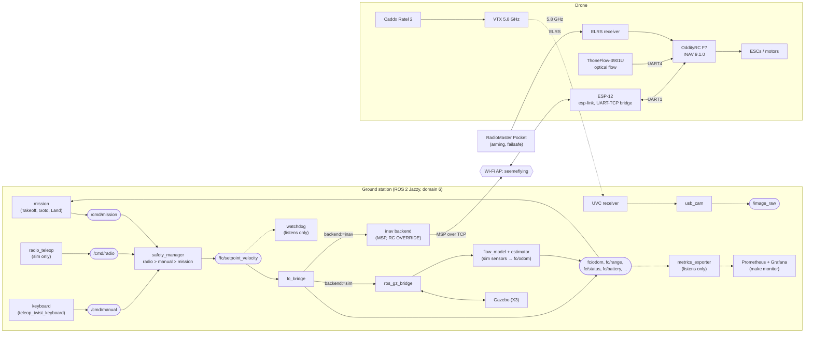
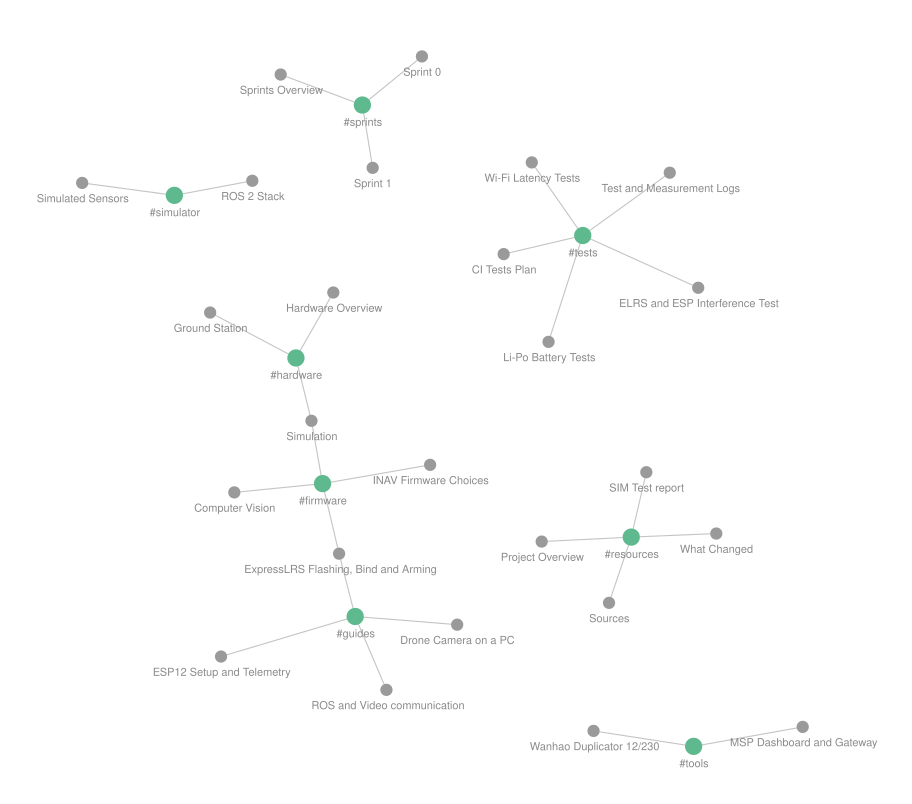

# See Me Flying — Autonomous Indoor Drone

SEA:ME 2.0 drone track · Team 4 · last updated Nov 19, 2026

An indoor autonomous drone built on a Pilotix Brook 2.5" running **INAV 9.1.0**, commanded from a **ROS 2 Jazzy** ground stack over Wi-Fi (MSP through an ESP8266 running esp-link). The drone flies in a room of at most 10 × 10 m, without GPS.

---
## Contents

1. [Quick start](#quick-start)
2. [Quick reference](#quick-reference)
3. [Architecture](#architecture)
4. [Repository layout](#repository-layout)
5. [Documentation map](#documentation-map)
6. [Using the Makefile](#using-the-makefile)
7. [ROS 2 stack](#ros-2-stack)
8. [Hardware](#hardware)
9. [Flight controller (INAV)](#flight-controller-inav)
10. [Telemetry over Wi-Fi](#telemetry-over-wi-fi)
11. [FPV video into ROS](#fpv-video-into-ros)
12. [Status and roadmap](#status-and-roadmap)
13. [Branches and contributing](#branches-and-contributing)
14. [Sources](#sources)

---

## Quick start

### Prerequisites

- Linux host (Ubuntu 22.04–26.04 or Arch)
- Docker Engine with the Compose plugin (**not** Docker Desktop — `network_mode: host` breaks ROS discovery there)
- Your user in the `docker` group

### First time

```bash
git clone https://github.com/SEAME-pt/See_Me_Flying.git
cd See_Me_Flying
make up             # write .env and start the container (first time: builds the image)
make sim-keyboard   # builds the ROS code (make ws), then flies in Gazebo with the keyboard
```

`make` on its own lists every command.

---

## Quick reference

| Item | Value |
| --- | --- |
| **`ROS_DOMAIN_ID`** | **`6`** |
| ROS 2 distro | Jazzy (Docker container `seame-dev`, image `seame/ros2-dev:jazzy`) |
| Simulator | Gazebo Harmonic, drone X3. Worlds: `room_world.sdf` (used by `make sim-*`), `outdoor_field.sdf`, and Gazebo's `multicopter_velocity_control.sdf` (the launch default) |
| Flight controller | OddityRC F7 40A AIO (STM32F722), INAV 9.1.0, custom target `ODDITYRCF7AIO` (Configurator 9.1.1) |
| FC ↔ ground link | ESP-12E/F (ESP8266) running esp-link 3.2.47, Wi-Fi AP `seemeflying`, TCP `192.168.4.1:23`, UART1 at 115200 baud |
| Radio | RadioMaster Pocket, ExpressLRS 4.1.0 (BETAFPV Nano RX), 2.4 GHz |
| Video | Caddx Ratel 2 analog → 5.8 GHz VTX → USB UVC receiver → ROS `/image_raw` |
| Ground station | Raspberry Pi 5 (16 GB, AI HAT+) and team laptops ([details](docs/Groundstation.md)) |
| Monitoring | Grafana on http://localhost:3000, metrics exporter on port 9105 |

### ROS_DOMAIN_ID = 6

The SEA:ME network is shared between teams. ROS 2 nodes only discover each other when they share the same `ROS_DOMAIN_ID`, so **every machine and container on our team must use `6`**, and no other team may use it. Valid range is 1–101 (`0` is the default and likely used by others by accident; above 101 can clash with OS ephemeral ports).

The container gets it from `compose.yaml` (`ROS_DOMAIN_ID=${ROS_DOMAIN_ID:-6}`). `make up` rewrites `.env` every time and doesn't put the domain in it, so don't set it there.

Check it inside the container (`make shell`):

```bash
echo $ROS_DOMAIN_ID   # must print 6
```

On the Raspberry Pi or any machine running ROS outside Docker, add `export ROS_DOMAIN_ID=6` to `~/.bashrc`.

> The tests deliberately use their own domains, localhost only (`ROS_AUTOMATIC_DISCOVERY_RANGE=LOCALHOST`): 199 for the `drone_fc_bridge` tests, 198 for `drone_bringup`'s stack test and 196 for the Gazebo flight test. Test runs never leak onto the team domain, and a running sim never disturbs a test.

---

## Architecture

### System diagram



### Key design rules

- **`fc_bridge` is the only node allowed to command the drone, and `safety_manager` is the only node that feeds it.** Every source publishes on its own topic (`/cmd/radio`, `/cmd/manual`, `/cmd/mission`); `safety_manager` forwards the highest-priority one that is publishing to `/fc/setpoint_velocity`, and the bridge clamps it.
- **Arming stays on the radio.** ROS never arms the real drone: `fc_bridge` with `backend:=inav` refuses `fc/arm` and has no sim-only enable topic.
- **Two failsafe layers.**
  - *ROS side:* `fc_bridge` sends zero velocity (hover) when setpoints go stale (0.3 s). To the real drone (with `rc_override`) that is centred sticks, which is only a hover with altitude and position hold.
  - *FC side:* INAV's RX failsafe `DROP` after 0.5 s.
- **ROS reaches the real drone's sticks only through INAV's MSP RC OVERRIDE mode**, on the radio's SA switch (channel 7), and only on the four stick channels (`msp_override_channels = 15`), never on AUX. Unarmed, the override keeps applying with the radio off; armed (props off, Nov 17), the RX failsafe still disarms the drone with it on.
- **Watchers never command.** `watchdog` and `metrics_exporter` only listen.

---

## Repository layout

Everything for the drone is under `project/`. The repo root only has what you run things with, plus the documentation.

```
See_Me_Flying/
├── README.md                    ← this file
├── Makefile                     every command (make help)
├── compose.yaml                 dev container (seame-dev) + monitoring profile
├── monitoring/                  Prometheus config + Grafana "Drone health" dashboard
├── docs/                        guides, test reports, sources (see the documentation map)
├── sprints/                     sprint plans and reviews
├── .github/                     CI (ci.yml, nightly.yml), issue template
└── project/
    ├── Dockerfile               ROS 2 Jazzy image (Gazebo, camera, CV packages, onnxruntime)
    ├── ros2/                    the colcon workspace (mounted as ~/ros2_ws in the container)
    │   ├── README.md            every node, topic, parameter, test and known issue
    │   └── src/
    │       ├── drone_bringup/   sim.launch.py, config/sim.yaml, worlds/, models/room/, stack tests
    │       ├── drone_fc_bridge/ fc_bridge (the only node that commands the drone) + watchdog
    │       ├── drone_interfaces/ FcStatus, OpticalFlow, RcChannels, MotorOutputs; Takeoff, Goto, Land
    │       ├── drone_mission/   mission (action servers) + demo_flight
    │       ├── drone_safety/    safety_manager (picks the command source)
    │       ├── drone_sim/       flow_model, estimator, flow_check, odom_check
    │       ├── drone_teleop/    radio_teleop (RadioMaster in the sim)
    │       └── drone_monitoring/ metrics_exporter
    ├── scripts/                 what the Makefile runs (sim, tests, bench, motor music, logbook)
    │   └── ros2_tools/          arm_bounce.py, odom_yaw.py
    ├── telemetry/               MSP tools for the ground computer, ESP12 setup guide
    │   ├── inav/                INAV firmware notes, MSP captures and rate runs
    │   ├── msp_dashboard/       C++ terminal dashboard + msp_gateway
    │   └── tests/               MSP framing and decoder tests (pytest)
    ├── hardware/                3D-print files, FC backups and target, ESC settings, ELRS build, wiring
    └── logs/                    every test run and measurement, one dated folder each
        ├── tests/               make test
        ├── sim_flight/          make sim-test
        └── measurements/        inav_link, inav_rc_override, motor_music, wifi_rtt
```

---

## Documentation map



| Area | Document |
| --- | --- |
| ROS 2 | [ROS 2 stack: nodes, topics, parameters, tests, known issues](project/ros2/README.md) |
| Simulator | [Simulated sensors (flow, rangefinder, estimator)](docs/SIM_Sensors.md) |
| Tests | [CI tests: what exists and what to add](docs/CI_Tests.md) · [Logs: test runs and measurements](project/logs/README.md) |
| Tests | [Wi-Fi latency](docs/Telemetry_test.md) · [ELRS and ESP interference](docs/ELRS_ESP_Interferance.md) · [Li-Po battery readings](docs/Li-Po_Battery_Tests.md) |
| Hardware | [Hardware overview](project/hardware/README.md) · [Ground station](docs/Groundstation.md) |
| Firmware | [INAV firmware choices](project/telemetry/inav/README.md) · [ExpressLRS flashing, bind and arming](docs/ELRS_Guide.md) |
| Guides | [ESP12 setup and telemetry](project/telemetry/README.md) · [FPV video into ROS](docs/FPV_Video_Receiver_Setup_UVC_Receiver_to_ROS.md) · [Camera on a PC](docs/Video_Transmission.md) |
| Tools | [MSP dashboard and gateway](project/telemetry/msp_dashboard/README.md) · [Wanhao Duplicator 12/230](docs/Wanhao_Duplicator_12-230.md) |
| Sprints | [Sprints overview](docs/sprints/README.md) |
| Resources | [What changed when copy-nando became main](docs/CHANGES.md) · [Sources](docs/Sources.md) |

### Using obsidian

The documentation was made with [Obsidan](https://obsidian.md/) and it's meant way easier to navigate through it using this tool. The setup is simple, after cloning the repository just open it as a vault inside Obsidian.

---

## Using the Makefile

Run everything from the repo root. `make` (or `make help`) lists all commands. No script needs to be called by hand.

### Overview

| Command | What it does |
|---|---|
| `make up` / `make build` | Write `.env` and start the container / rebuild the image |
| `make ws` | Build the ROS code (`colcon build`) |
| `make sim-keyboard`, `make sim-joy` | Build, then Gazebo with the keyboard or the RadioMaster; both ask for the camera |
| `make test`, `make sim-test` | All tests like CI / the headless Gazebo flight test; results in `project/logs/` |
| `make monitor` | Grafana dashboard on http://localhost:3000 |
| `make bench`, `make wifi-rtt`, `make capture`, `make bench-rc`, `make bench-armed`, `make motor-music` | Real drone, props off |

### Start

```bash
make up      # write .env (your UID/GID and GPU groups) and start the container
make ws      # build the ROS code
```

After pulling a change to `project/Dockerfile`, run `make build` once, then `make up`.

### Simulation

```bash
make sim-keyboard   # Gazebo + keyboard (no radio: the drone starts armed)
make sim-joy        # Gazebo + RadioMaster Pocket over USB
make sim-stop       # stop every sim process left in the container
```

Both build the workspace first, fly in `room_world.sdf`, and ask for the camera before starting:

```
1) FPV (the drone's front camera)
2) Follow mode (behind the drone)
3) Normal camera (free)
```

The keyboard publishes on `/cmd/manual`. To fly the scripted square instead, launch by hand with `ros2 launch drone_bringup sim.launch.py radio:=false demo:=true` (every launch argument is in the [ROS 2 stack](project/ros2/README.md#launch-files)).

#### Flying with the RadioMaster (`sim-joy`)

Use the Pocket's `INAV-SIM` model copy, with Internal RF off.

1. Plug it in by USB and choose **USB Joystick (HID)** on the radio.
2. Arm: switch **SA** off, throttle stick in the **middle**, SA on.
3. Fly: flip the **takeover** switch (other shoulder) on.
4. SA off disarms at once, even in the air.

> These are the sim's switches. On the real drone the radio arms INAV itself (ARM on SD with PREARM on SE), and SA is the MSP RC OVERRIDE switch.

### Monitoring

```bash
make monitor        # Grafana dashboard on http://localhost:3000
make monitor-stop   # stop it (its data is kept)
```

The dashboard opens without logging in; log in as `admin`/`admin` to edit it. It shows data while a sim or the drone stack runs.

### Tests

```bash
make test       # every ROS and telemetry test, like CI (~2 min): project/logs/tests/
make sim-test   # full headless Gazebo flight, like the nightly job (~2 min): project/logs/sim_flight/
```

Commit the run folder and `history.csv` with the code it tested. How to read the results: [Logs](project/logs/README.md).

### Real drone (laptop on the drone's Wi-Fi)

> **Props off** for the bench runs. They are interactive: they tell you what to do with the radio.

```bash
make bench NOTE="bench, AP mode"         # full check: sensors, noise, link under load
make wifi-rtt NOTE="bench, AP mode"      # Wi-Fi round trip to the FC only
make capture STATE=flat_still            # record MSP replies for the tests
make bench-rc                            # ROS sticks through MSP RC OVERRIDE, unarmed
make bench-armed                         # armed, ROS drives the motors
make motor-music MODE=calibrate          # the motors play a song
make motor-music MODE=play SONG=path/song.rtttl
```

`bench`, `wifi-rtt` and `capture` all run `msp_bench.py` and talk to esp-link (192.168.4.1, port 23) by default; on the Raspberry Pi, pass `ARGS="--serial /dev/ttyUSB0"` ([telemetry README](project/telemetry/README.md#msp_benchpy)). The bench targets take `INSTALL=<path>` to run another build. Results go to `project/logs/measurements/`.

### Other commands

```bash
make shell           # terminal inside the container
make logs            # follow the container's output
make down            # stop the container (and monitoring)
make build           # rebuild the image after changing project/Dockerfile
make ws-clean        # delete build/, install/ and log/, then run make ws
make clean-volumes   # also delete the Gazebo model cache and monitoring data
```

### Troubleshooting

| Problem | Fix |
|---|---|
| "seame-dev is already in use" | Another copy of the repo has its container running. Run `docker rm -f seame-dev`. |
| "Gazebo is already running" | `make sim-stop` |
| "Package not found" | `make ws` |
| "make-env.sh: Permission denied" | `chmod +x project/scripts/make-env.sh` |
| Joystick not found (`ls /dev/input/js*` shows nothing) | Try another USB cable or port. `journalctl -kf \| grep -i usb` must not show `error -71`. |
| Drone ignores the RadioMaster | It isn't armed. Centre the throttle, then flip SA off and on. |
| Grafana shows NO DATA | Start a sim first. |

---

## ROS 2 stack

Every node, topic, parameter, test and known issue in detail: [ROS 2 stack](project/ros2/README.md).

### Processes

| Process | Language | Package | Role |
| --- | --- | --- | --- |
| `gz sim` | C++ (not a ROS node) | `ros_gz_sim` | Physics, X3 quadcopter with built-in velocity controller |
| `parameter_bridge` | C++ | `ros_gz_bridge` | Copies `/X3/gazebo/command/twist`, `/X3/enable` (ROS→Gz) and `/clock`, odometry (Gz→ROS) |
| `fc_bridge` | C++ | `drone_fc_bridge` | 20 Hz; clamps setpoints, sends zero when stale; `sim` and `inav` backends |
| `watchdog` | C++ | `drone_fc_bridge` | Warns when setpoints stop/resume; commands nothing |
| `safety_manager` | Python | `drone_safety` | The only publisher of `/fc/setpoint_velocity`: radio > manual > mission |
| `mission`, `demo_flight` | Python | `drone_mission` | Takeoff, Goto and Land action servers; a scripted square |
| `radio_teleop` | Python | `drone_teleop` | RadioMaster sticks → `/cmd/radio` (sim only) |
| `flow_model`, `estimator` | Python | `drone_sim` | Simulated optical flow; `fc/odom` from flow, range and attitude (sim only) |
| `flow_check`, `odom_check` | Python | `drone_sim` | Run by hand: sensors and estimator vs ground truth |
| `metrics_exporter` | Python | `drone_monitoring` | Topics → Prometheus metrics on port 9105; listens only |

### Contract topic

**`/fc/setpoint_velocity`** (`geometry_msgs/TwistStamped`, frame `base_link`), published only by `safety_manager`.

### fc_bridge limits

All live-tunable with `ros2 param set` (doubles only):

| Parameter | Value |
| --- | --- |
| `setpoint_timeout_s` | 0.3 s |
| `max_speed_xy` | 0.5 m/s (direction kept, speed capped) |
| `max_speed_z` | 0.3 m/s |
| `max_yaw_rate` | 1.0 rad/s |

Agreed targets for the real link (ALL 1.1): control loop **50 Hz** (minimum 20 Hz), bridge watchdog **200 ms**. On the real drone the `inav` backend polls at about 8.6–10 cycles/s, and a setpoint reaches INAV 150–270 ms after it is published.

### Interfaces (`drone_interfaces`)

- Messages: `FcStatus` (backend, armed, holding, setpoint age, range valid, and with `inav` `link_ok`, `state_age_s`, `rc_override_active`, `rc_sent`), `OpticalFlow`, `RcChannels`, `MotorOutputs`
- Actions: `Takeoff`, `Goto`, `Land`

### Watchdog

Always running, now in `drone_fc_bridge`. It watches `/fc/setpoint_velocity` (what fc_bridge receives) and warns when nothing arrives for 0.5 s, and again when it is back. It only warns; fc_bridge's own 0.3 s timeout is what sends zero. Tested in `drone_fc_bridge/test/test_watchdog.py`.

### Monitoring

`metrics_exporter` turns the fc_bridge, sensor and safety_manager topics into Prometheus metrics on port 9105. `make monitor` starts Prometheus and Grafana with the **"Drone health"** dashboard:

- backend, armed, active source, battery, hold
- FC link, height
- topic rates and stale topics

Scripts and the logbook use plain `Error:`, `WARNING:` and `STOP:` messages (no emojis).

---

## Hardware

| Part              | Model                                                        | Notes                                                                         |
| ----------------- | ------------------------------------------------------------ | ----------------------------------------------------------------------------- |
| Frame             | Pilotix Brook 2.5" cinewhoop                                 | Prop guards; high-KV motors                                                   |
| Flight controller | OddityRC F7 40A AIO, STM32F722RET6 (512 KB flash)            | 5 UARTs; too little flash for ArduPilot                                       |
| Receiver          | [ELRS 2.4 GHz](docs/ELRS_Guide.md)                           | Replaced the TBS Crossfire XF Nano RX V3 with a BETAFPV Nano RX on ELRS 4.1.0 |
| Camera / VTX      | Caddx Ratel 2 + PandaRC VT5804 Bat Lite (5.8 GHz)            | Analog; VTX (IRC Tramp, UART3) set to band A ch1, 5865 MHz, 25 mW             |
| Optical flow      | ThoneFlow-3901U (PMW3901)                                    | UART4, no rangefinder; notch points to the back                               |
| Flow + rangefinder | MicoAir MTF-02P                                             | Chosen by the team and modelled in the sim; not fitted yet (Nov 16)           |
| Wi-Fi             | [ESP-12E/F (ESP8266)](project/telemetry/README.md)           | esp-link 3.2.47, UART1; replaces the GoPro mount                              |
| Radio             | RadioMaster Pocket                                           | EdgeTX, ELRS 4.1.0                                                            |
| 3D printer        | [Wanhao Duplicator 12/230](docs/Wanhao_Duplicator_12-230.md) | Mounts sliced with PrusaSlicer                                                |

### Wiring plan (Sprint 0)

| UART | Device | Voltage |
| --- | --- | --- |
| UART1 | ESP8266 (MSP) | 5 V |
| UART3 | VTX (IRC Tramp) | — |
| UART4 | ThoneFlow | 3.3 V |
| UART6 | free for add-ons | — |

Wiring diagram: [`project/hardware/wiring/wire_diagram.png`](project/hardware/wiring/wire_diagram.png). [Hardware report in more detail](project/hardware/README.md).

---

## Flight controller (INAV)

- **Firmware:** INAV 9.1.0 on custom target `ODDITYRCF7AIO`, derived from `AOCODARCF722AIO` (gyro `CW180_DEG → CW90_DEG`, LEDs on PA14/PA13, sensor scale 250 → 179). Configured with INAV Configurator 9.1.1.
- **Why INAV:** ArduPilot doesn't fit in 512 KB; Betaflight has no autonomous modes and no ThoneFlow/optical-flow position hold. INAV has baro altitude hold, controlled emergency landing and optical-flow support. Full reasoning: [INAV firmware choices](project/telemetry/inav/README.md).
- **Arming:** ARM on AUX1 (ch5, switch SD) and PREARM on AUX2 (ch6, button SE), active at 1700–2100. Two-switch interlock, prearm window 3 s. ANGLE is on AUX1 too, so the drone is always in ANGLE when armed.
- **MSP RC OVERRIDE:** on AUX3 (ch7, switch SA), `msp_override_channels = 15` (the four sticks only).
- **Failsafe:** `DROP` on radio loss, after 0.5 s.
- **Calibration:** accelerometer gains X 4096 / Y 4098 / Z 4095; board alignment fixed from the Sensors tab; `vbat_scale = 1103` ([battery tests](docs/Li-Po_Battery_Tests.md)).
- **Motors:** DSHOT300, 12 poles, props-out, Bluejay ESCs.

Config backups (INAV `diff all` from 26 Oct 2026, the original Betaflight 4.5.1 fallback, the calibration) and the custom target build are in [`project/hardware/flight-controller/`](project/hardware/flight-controller/). The Nov 17 changes for MSP RC OVERRIDE: [`fc_config_2026-11-17`](project/logs/measurements/inav_rc_override/fc_config_2026-11-17/README.md).

---

## Telemetry over Wi-Fi

The ESP12 runs **esp-link**: it opens its own access point and passes every byte between a TCP client (port 23) and the FC's UART1, with no MSP parsing on the ESP. Setup and every telemetry field: [ESP12 setup](project/telemetry/README.md).

```bash
python3 project/telemetry/inav_telemetry.py --port 23                    # readable output
python3 project/telemetry/inav_telemetry.py --port 23 --info --rate 2    # JSON lines
```

**Transport:** TCP. esp-link's UDP needs client code on the other end, which INAV can't run ([Wi-Fi latency tests](docs/Telemetry_test.md)). Round trips are bimodal (about half under 40 ms, many 140–180 ms) with a tail past 0.75 s, so control loops are planned around the tail, not the mean.

**One client at a time:** a second client on the drone's ESP (Nov 18: a Raspberry Pi with another ESP) caused link dropouts that handed the sticks back to the radio. Keep the drone's ESP to one client, or put [`msp_gateway`](project/telemetry/msp_dashboard/README.md) in front as the only owner of the link.

---

## FPV video into ROS

USB UVC receiver on the ground computer (`/dev/video2`) → `usb_cam` in the container → **`/image_raw`** at ~25 Hz, view with `rqt_image_view`.

`compose.yaml` already maps `/dev`, adds the video cgroup rule (`c 81:* rmw`) and the host's `video` group, and the image has the camera packages.

[The step-by-step guide](docs/FPV_Video_Receiver_Setup_UVC_Receiver_to_ROS.md).

---

## Status and roadmap

| Sprint | Period | Focus |
| --- | --- | --- |
| [Sprint 0](sprint_0.md) ✔ | 6–16 Oct 2026 | Onboarding, dev container, wiring plan, INAV flashing, setpoint publisher + watchdog |
| [Sprint 1](sprint_1.md) ✔ | 19 Oct – 1 Nov 2026 | INAV telemetry over Wi-Fi, sim stack + teleop, FPV video to ROS, CI |

### Done

- INAV flashed and calibrated; ESP12 bridge on esp-link
- Sim stack flying in Gazebo, with FPV / follow / free camera and the room world
- `safety_manager` (one commander at a time, the radio overrides) and `mission` (Takeoff, Goto, Land on the rangefinder)
- Simulated optical flow and the estimator (`fc/odom` from flow, range and attitude)
- FPV video in ROS
- `inav` backend in `fc_bridge`: state from the real drone (Nov 16), sticks over MSP RC OVERRIDE, motor outputs, bench-tested props off (Nov 17)
- Wi-Fi latency measured (Nov 12)
- Monitoring with Prometheus and Grafana
- CI on every push and PR, plus a nightly Gazebo flight test

### Next

- Fit the MTF-02P and replace the sim's placeholder noise with bench data
- Altitude hold before ROS flies the real drone: in ANGLE, a centred throttle from ROS is raw half throttle
- Check the yaw direction with the radio (props off), then a first flight with ROS sticks
- `fc/imu`, and a low-battery action in `safety_manager` (today it only warns)
- Perception node on `/image_raw`; camera calibration and glass-to-screen latency

---
## Branches and contributing

| Branch | Purpose |
| --- | --- |
| `main` | Stable, reviewed work |
| `test`, `staging` | Integration branches |
| `docs` | The old documentation layout, before this refactor |
| feature branches (e.g. `motor-music`) | Feature work, merged into `main` by pull request |

### Pull requests

- Open a PR into `main` with the [PR template](docs/pull_request_template.md) and link the issue (issue template in `.github/ISSUE_TEMPLATE/`).
- Run `make test` first and commit its run folder with the code.
- Never commit `.env`, `build/`, `install/` or `log/`.

### CI

`.github/workflows/ci.yml` runs on every push and PR to `main`, `test` and `ci/**`:

- `ros2-build-test`: builds `project/ros2` in the plain `ros:jazzy` image and runs `colcon test`
- `telemetry-python`: syntax check, flake8 and pytest on `project/telemetry`
- `docker-image`: proves `project/Dockerfile` still builds
- `block-red-pr`: if any of these fails on a PR, the PR goes back to draft

`.github/workflows/nightly.yml` flies the Gazebo flight test every night at 02:00 UTC, from the Actions tab, and on PRs that change the sim. `make test` and `make sim-test` run the same things locally.

---

## Sources

Every source that we used is in the [sources file](docs/Sources.md).


# Tags

#resources
