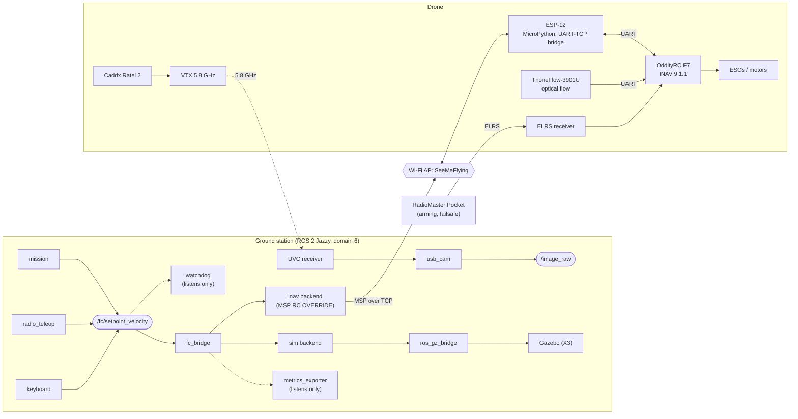

# See Me Flying — Autonomous Indoor Drone

SEA:ME 2.0 drone track · Team 4 · last updated Nov 19, 2026

An indoor autonomous drone built on a Pilotix Brook 2.5" running **INAV 9.1.1**, commanded from a **ROS 2 Jazzy** ground stack over Wi-Fi (MSP through an ESP8266). The drone flies in a room of at most 10 × 10 m, without GPS.

---
## Contents

1. [Quick start](#quick-start)
2. [Quick reference](#quick-reference)
3. [Architecture](#architecture)
4. [Repository layout](#repository-layout)
5. [Using the Makefile](#using-the-makefile)
6. [ROS 2 stack](#ros-2-stack)
7. [Hardware](#hardware)
8. [Flight controller (INAV)](#flight-controller-inav)
9. [FPV video into ROS](#fpv-video-into-ros)
10. [Status and roadmap](#status-and-roadmap)
11. [Branches and contributing](#branches-and-contributing)
12. [Sources](#sources)

---

## Quick start

### Prerequisites

- Linux host (Ubuntu 22.04–26.04 or Arch)
- Docker Engine with the Compose plugin (**not** Docker Desktop — `network_mode: host` breaks ROS discovery there)
- Your user in the `docker` group

### First time

```bash
git clone https://github.com/SEAME-pt/See_Me_Flying.git
cd See_Me_Flying
make up             # start the container (first time: builds the image)
make ws             # build the ROS code
make sim-keyboard   # fly in Gazebo with the keyboard
```

---

## Quick reference

| Item | Value |
| --- | --- |
| **`ROS_DOMAIN_ID`** | **`6`** |
| ROS 2 distro | Jazzy (Docker container `seame-dev`) |
| Simulator | Gazebo Harmonic, world `multicopter_velocity_control.sdf`, drone X3 |
| Flight controller | OddityRC F7 40A AIO (STM32F722), INAV 9.1.1, custom target `ODDITYRCF7AIO` |
| FC ↔ ground link | ESP-12E/F (ESP8266, MicroPython), Wi-Fi AP `SeeMeFlying`, TCP `192.168.4.1:5760`, UART 115200 baud |
| Radio | RadioMaster Pocket, ExpressLRS 4.1.0 (BETAFPV Nano RX), 2.4 GHz |
| Video | Caddx Ratel 2 analog → 5.8 GHz VTX → USB UVC receiver → ROS `/image_raw` |
| Ground station | Raspberry Pi 5 (16 GB, AI HAT+) and team laptops |
| Monitoring | Grafana on http://localhost:3000, metrics exporter on port 9105 |

### ROS_DOMAIN_ID = 6

The SEA:ME network is shared between teams. ROS 2 nodes only discover each other when they share the same `ROS_DOMAIN_ID`, so **every machine and container on our team must use `6`**, and no other team may use it. Valid range is 1–101 (`0` is the default and likely used by others by accident; above 101 can clash with OS ephemeral ports).

It is already the default in the repo:

- `compose.yaml` → `ROS_DOMAIN_ID=${ROS_DOMAIN_ID:-6}`
- `project/scripts/make-env.sh` → prompts with `[6]` as default

Check it inside the container:

```bash
echo $ROS_DOMAIN_ID   # must print 6
```

On the Raspberry Pi or any machine running ROS outside Docker, add `export ROS_DOMAIN_ID=6` to `~/.bashrc`.

> The CI tests in `drone_fc_bridge` deliberately use `ROS_DOMAIN_ID=199` with `ROS_AUTOMATIC_DISCOVERY_RANGE=LOCALHOST`, so test runs never leak onto the team domain.

---

## Architecture

### System diagram



### Key design rules

- **`fc_bridge` is the only node allowed to command the drone.** All sources publish to `/fc/setpoint_velocity`; the bridge clamps and forwards them.
- **Arming stays on the radio.** ROS never arms the real drone. The sim-only "enable" topic does not exist in the `inav` backend.
- **Two failsafe layers.**
  - *ROS side:* `fc_bridge` sends zero velocity (hover) when setpoints go stale. To the real drone (with `rc_override`) that is centred sticks, which is only hover with altitude and position hold.
  - *FC side:* INAV's RX failsafe `DROP` after 0.5 s.
- **ROS reaches the real drone's sticks only through INAV's MSP RC OVERRIDE mode**, on a radio switch (SA). Unarmed, the override keeps applying with the radio off; armed (props off, Nov 17), the RX failsafe still disarms the drone with it on.
- **Watchers never command.** `watchdog` and `metrics_exporter` only listen.

---

## Repository layout

Everything for the drone is under `project/`. The repo root only has what you run things with.

```
See_Me_Flying/
├── README.md                 ← this file
├── Makefile                  every command (make help)
├── compose.yaml              dev container (seame-dev)
├── monitoring/               Prometheus + Grafana, "Drone health" dashboard
├── .github/ISSUE_TEMPLATE/   issue template
└── project/
    ├── Dockerfile            ROS 2 Jazzy image (incl. CV packages, onnxruntime)
    ├── ros2/src/
    │   ├── drone_bringup/    launch files, config (incl. config/gui/), worlds, models/room/
    │   ├── drone_fc_bridge/  fc_bridge (the only node that commands the drone) + watchdog
    │   ├── drone_interfaces/ FcStatus, MotorOutputs, RcChannels
    │   ├── drone_sim/        sim sensors, odom_check
    │   ├── drone_teleop/     radio_teleop
    │   └── drone_monitoring/ metrics_exporter
    ├── scripts/              make-env.sh, sim_keyboard.sh, sim_joy.sh, bench scripts
    │   └── ros2_tools/
    ├── telemetry/            INAV ⇄ Wi-Fi bridge (inav_telemetry.py)
    └── logs/                 test results
        ├── tests/            test logbook
        └── measurements/     inav_link, inav_rc_override, motor_music, …
```


---

## Using the Makefile

Run everything from the repo root. `make` (or `make help`) lists all commands. No script needs to be called by hand.

### Overview

| Command | What it does |
|---|---|
| `make up` / `make build` | Start the container / rebuild the image |
| `make ws` | Build the ROS code |
| `make sim-keyboard`, `make sim-joy` | Gazebo with keyboard or RadioMaster; both ask for the camera |
| `make test`, `make sim-test` | All tests, Gazebo flight test; results in `project/logs/` |
| `make monitor` | Grafana dashboard on http://localhost:3000 |
| `make wifi-rtt`, `make bench-rc`, `make bench-armed`, `make motor-music` | Real drone, props off |

### Start

```bash
make up      # start the container (first time: builds the image)
make ws      # build the ROS code
```

After pulling a change to `project/Dockerfile`, run `make build` once.

### Simulation

```bash
make sim-keyboard   # Gazebo + keyboard (the drone starts armed)
make sim-joy        # Gazebo + RadioMaster Pocket over USB
make sim-stop       # stop the sim
```

Both ask for the camera before starting:

```
1) FPV (the drone's front camera)
2) Follow mode (behind the drone)
3) Normal camera (free)
```

The `mission` node with `demo:=true` flies a square.

#### Flying with the RadioMaster (`sim-joy`)

1. Plug it in by USB and choose **USB Joystick (HID)** on the radio.
2. Arm: switch **SA** off, throttle stick in the **middle**, SA on.
3. Fly: flip the **takeover** switch (other shoulder) on.
4. SA off disarms at once, even in the air.

### Monitoring

```bash
make monitor        # Grafana dashboard on http://localhost:3000
make monitor-stop   # stop it (its data is kept)
```

The dashboard shows data while a sim or the drone stack runs.

### Tests

```bash
make test       # all tests (~2 min)
make sim-test   # full Gazebo flight (~2 min)
```

Results go to `project/logs/`.

### Real drone (laptop on the drone's Wi-Fi)

> **Props off** for the bench runs. They are interactive: they tell you what to do with the radio.

```bash
make wifi-rtt NOTE="bench, AP mode"      # Wi-Fi round trip to the FC
make bench-rc                            # ROS sticks through MSP RC OVERRIDE, unarmed
make bench-armed                         # armed, ROS drives the motors
make motor-music MODE=calibrate          # the motors play a song
make motor-music MODE=play SONG=path/song.rtttl
```

Results go to `project/logs/measurements/`.

### Other commands

```bash
make shell           # terminal inside the container
make logs            # follow the container's output
make down            # stop the container (and monitoring)
make build           # rebuild the image after changing project/Dockerfile
make ws-clean        # delete the build, then run make ws
make clean-volumes   # also delete the Gazebo model cache and monitoring data
```

### Troubleshooting

| Problem | Fix |
|---|---|
| "seame-dev is already in use" | Another copy of the repo has its container running. Run `docker rm -f seame-dev`. |
| "Gazebo is already running" | `make sim-stop` |
| "Package not found" | `make ws` |
| "make-env.sh: Permission denied" | `chmod +x project/scripts/make-env.sh` |
| Joystick not found (`ls /dev/input/js*` shows nothing) | Try another USB cable or port. `journalctl -kf \| grep -i usb` must not show `error -71`. |
| Drone ignores the RadioMaster | It isn't armed. Centre the throttle, then flip SA off and on. |
| Grafana shows NO DATA | Start a sim first. |

---

## ROS 2 stack

### Processes

| Process | Language | Package | Role |
| --- | --- | --- | --- |
| `gz sim` | C++ (not a ROS node) | `ros_gz_sim` | Physics, X3 quadcopter with built-in velocity controller |
| `parameter_bridge` | C++ | `ros_gz_bridge` | Copies `/X3/gazebo/command/twist`, `/X3/enable` (ROS→Gz) and `/clock` (Gz→ROS) |
| `fc_bridge` | C++ | `drone_fc_bridge` | 20 Hz; clamps setpoints, sends zero velocity when stale; sim and INAV backends |
| `watchdog` | C++ | `drone_fc_bridge` | Warns when setpoints stop/resume; commands nothing |
| `radio_teleop` | Python | `drone_teleop` | RadioMaster sticks → setpoints |
| `odom_check` | — | `drone_sim` | Estimator vs ground truth: `ros2 run drone_sim odom_check` |
| `metrics_exporter` | — | `drone_monitoring` | Topics → Prometheus metrics on port 9105; listens only |

### Contract topic

**`/fc/setpoint_velocity`** (`geometry_msgs/TwistStamped`, frame `base_link`).

### fc_bridge limits

All live-tunable with `ros2 param set` (doubles only):

| Parameter | Value |
| --- | --- |
| `setpoint_timeout_s` | 0.3 s |
| `max_speed_xy` | 0.5 m/s (direction kept, speed capped) |
| `max_speed_z` | 0.3 m/s |
| `max_yaw_rate` | 1.0 rad/s |

Agreed targets for the real link (ALL 1.1): control loop **50 Hz** (minimum 20 Hz), bridge watchdog **200 ms**.

### Interfaces (`drone_interfaces`)

- `FcStatus`, with the fields `link_ok`, `state_age_s`, `rc_override_active`, `rc_sent`
- `MotorOutputs`
- `RcChannels`

### Watchdog

Always running, same code as before, now in `drone_fc_bridge`. It watches `/fc/setpoint_velocity` (what fc_bridge receives) and warns when nothing arrives for 0.5 s, and again when it is back. It only warns; fc_bridge's own 0.3 s timeout is what sends zero. Tested in `drone_fc_bridge/test/test_watchdog.py`.

### Monitoring

`metrics_exporter` turns the fc_bridge, sensor and safety_manager topics into Prometheus metrics on port 9105. `make monitor` starts Prometheus and Grafana with the **"Drone health"** dashboard:

- armed, active source, battery, hold
- FC link, height
- topic rates and stale topics

Scripts and the logbook use plain `Error:`, `WARNING:` and `STOP:` messages (no emojis).

---

## Hardware

| Part              | Model                                                        | Notes                                                                         |
| ----------------- | ------------------------------------------------------------ | ----------------------------------------------------------------------------- |
| Frame             | Pilotix Brook 2.5" cinewhoop                                 | Prop guards; high-KV motors                                                   |
| Flight controller | OddityRC F7 40A AIO, STM32F722RET6 (512 KB flash)            | 5 UARTs; too little flash for ArduPilot                                       |
| Receiver          | ELRS 2.4 GHz                                                 | Replaced the TBS Crossfire XF Nano RX V3 with a BETAFPV Nano RX on ELRS 4.1.0 |
| Camera / VTX      | Caddx Ratel 2 + PandaRC VT5804 Bat Lite (5.8 GHz)            | Analog; VTX (IRC Tramp, UART3) set to band A ch1, 5865 MHz, 25 mW             |
| Optical flow      | ThoneFlow-3901U (PMW3901)                                    | UART, no rangefinder; notch points to the back                                |
| Wi-Fi             | [ESP-12E/F (ESP8266)](project/telemetry/README.md)           |                                                                               |
| Radio             | RadioMaster Pocket                                           | ELRS 4.1.0                                                                    |
| 3D printer        | [Wanhao Duplicator 12/230](docs/Wanhao_Duplicator_12-230.md) | Mounts sliced with PrusaSlicer                                                |

### Wiring plan (Sprint 0)

| UART | Device | Voltage |
| --- | --- | --- |
| UART1 | ESP8266 | 5 V |
| UART3 | VTX (IRC Tramp) | — |
| UART4 | ThoneFlow | 3.3 V |
| UART6 | free for add-ons | — |

[Hardware report in more detail is present on the project folder.](project/hardware/README.md)

---

## Flight controller (INAV)

- **Firmware:** INAV 9.1.1 on custom target `ODDITYRCF7AIO`, derived from `AOCODARCF722AIO` (gyro `CW180_DEG → CW90_DEG`, LEDs on PA14/PA13, sensor scale 250 → 179).
- **Why INAV:** ArduPilot doesn't fit in 512 KB; Betaflight has no autonomous modes and no ThoneFlow/optical-flow position hold. INAV has baro altitude hold, controlled emergency landing and optical-flow support.
- **Arming:** ARM on AUX1 (ch5) and PREARM on AUX2 (ch6), active at 1700–2100. Two-switch interlock: arm on SD, prearm on SE, prearm window 3 s.
- **Failsafe:** `DROP` on radio loss, after 0.5 s.
- **Calibration:** accelerometer gains X 4096 / Y 4098 / Z 4095; board alignment fixed from the Sensors tab.
- **Motors:** DSHOT300, 12 poles, props-out, Bluejay ESCs.

Config backups (current INAV `diff all` from 26 Oct 2026 and the original Betaflight 4.5.1 fallback) and the firmware reasoning are on the `docs` branch.

---

## FPV video into ROS

USB UVC receiver on the ground computer (`/dev/video2`) → `usb_cam` in the container → **`/image_raw`** at ~25 Hz, view with `rqt_image_view`.

The container needs:

- the device mapped
- the cgroup rule
- the `video` group

[The step-by-step guide is on the docs](/docs/FPV_Video_Receiver_Setup_UVC_Receiver_to_ROS.md).

---

## Status and roadmap

| Sprint | Period | Focus |
| --- | --- | --- |
| Sprint 0 ✔ | 6–16 Oct 2026 | Onboarding, dev container, wiring plan, INAV flashing, setpoint publisher + watchdog |
| Sprint 1 ✔ | 19 Oct – 1 Nov 2026 | INAV telemetry over Wi-Fi, sim stack + teleop, FPV video to ROS, CI |

### Done

- INAV flashed and calibrated
- ESP12 telemetry bridge
- Sim stack flying in Gazebo, with FPV / follow / free camera
- FPV video in ROS
- NaN guard and teleop
- INAV backend in `fc_bridge`: sticks over MSP RC OVERRIDE, motor outputs, bench-tested props off (logbook: 15 runs, 2–17 Nov)
- `drone_interfaces` (`FcStatus`, `MotorOutputs`, `RcChannels`)
- Monitoring with Prometheus and Grafana
- `odom_check` (estimator vs ground truth)

### Next

- Move control traffic to UDP; check `header.stamp` latency on the real link
- State back from the drone/sim: `fc/odom`, `fc/imu`, `fc/attitude`, `fc/battery`, `fc/status`
- Services `fc/arm` (refused on hardware) and `fc/hold`
- `safety_manager` and `mission` (takeoff, waypoints, landing)
- Perception node on `/image_raw`; optical-flow position hold indoors

---
## Branches and contributing

| Branch                                             | Purpose                              |
| -------------------------------------------------- | ------------------------------------ |
| `main`                                             | Stable, reviewed work                |
| `test`                                             | Integration branch                   |
| `docs`                                             | All documentation                    |
| `inav_docs`, `INAV/telemetry`, `feature/*`, `ci/*` | Feature work, merged by pull request |

### Pull requests

- Open a PR into `main` and link the issue (issue template in `.github/ISSUE_TEMPLATE/`).
- Never commit `.env`, `build/`, `install/` or `log/`.

### CI

`.github/workflows/ci.yml` runs on push/PR to `main` or `test`: it builds the ROS workspace in the plain `ros:jazzy` image and runs `colcon test`. Run the tests locally first:

```bash
make test
```

---

## Sources

Every source that we used is present on the [sources file](/docs/Sources.md).


# Tags

#resources