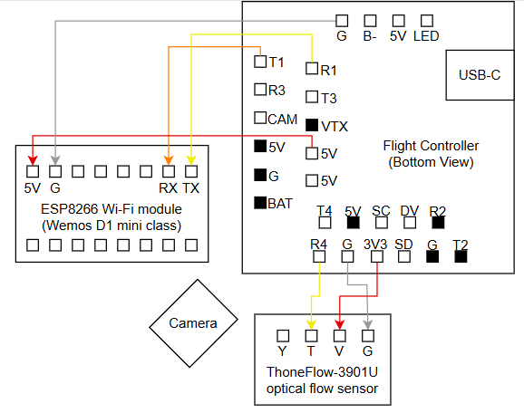

# Sprint 0 — Onboarding & Baseline

- **Period:** 6 October – 16 October 2026
- **Duration:** 2 weeks
- **Phase:** Onboarding & Baseline

### [Documents the selection of INAV 9.1.1 as the drone’s flight firmware, custom flight controller target configuration, sensor calibration, safety switch setup, and the technical challenges encountered during setup.](../../.assets/Hardware_software%20choices%20for%20Drone.md)

## 1. Sprint Objective

Establish the project's technical and organizational baseline, following the program's initial objectives:

- Development tooling and Git workflow.
- ROS 2 fundamentals and development environment.
- Team formation and collaboration.
- Initial hardware teardown and system familiarization.

The sprint also establishes the initial drone architecture, communication paths, and safety-monitoring approach.

## 2. Work Completed

### 2.1 Hardware

- Drafted the initial wiring plan covering the camera, Wi-fi module and optical flow sensor.
- Defined the ESP8266 to UART1, and the ThoneFlow sensor to UART4, leaving UART6 free for eventual hardware add-on.
- Connected the flow sensor to the 3.3V pad because it is sufficient to power it, and the Wi-Fi module to the general 5V power source.

### 2.2 ROS 2 + INAV

- Established a ROS 2 Jazzy development container to provide a consistent environment across hosts.
- Defined the initial command interface using a Python setpoint publisher and a C++ watchdog.
- Prepared the launch configuration and parameters:
  - Setpoint publishing frequency: **10 Hz**.
  - Watchdog timeout: **0.5 seconds**.

### 2.3 System Design

- Mapped the drone architecture to the program's four-layer reference model.
- Identified and documented the initial command, video, and safety paths.
- Broke down Milestone 1 into four development sprints.

## 3. Technical Baseline

| Component                   | Initial approach             |
| --------------------------- | ---------------------------- |
| Development environment     | ROS 2 Jazzy container        |
| Flight controller ecosystem | INAV                         |
| Command generation          | Python setpoint publisher    |
| Command monitoring          | C++ watchdog                 |
| Publishing frequency        | 10 Hz                        |
| Watchdog timeout            | 0.5 s                        |
| Hardware interface          | ESP8266 connected to FC UART |
| Sensors and peripherals     | Camera, optical flow, LEDs   |

## 4. Initial Safety Strategy

The initial design includes a watchdog to detect missing or delayed setpoint messages.

At a publishing frequency of 10 Hz, the expected interval between messages is 50 ms. A timeout of 300 ms corresponds to approximately six expected publishing intervals.

The intended behavior is to detect command loss and trigger a predefined safe response. The exact response, recovery behavior, and integration with the flight controller must be validated during implementation and testing.

## 5. Sprint Deliverables

- [x] Initial hardware wiring plan.
- [x] ESP8266-to-flight-controller UART mapping.
- [x] Shared ROS 2 Jazzy development environment defined.
- [x] Python publisher and C++ watchdog architecture defined.
- [x] Initial launch parameters identified.
- [x] Milestone 1 divided into four sprints.

## 6. Open Items

- [ ] Validate the complete hardware wiring and UART configuration.
- [ ] Implement and test the setpoint publisher.
- [ ] Implement watchdog timeout detection and the safe response.
- [ ] Validate the ROS 2–flight controller communication path.
- [ ] Document the four-layer architecture and communication interfaces.
- [ ] Define measurable acceptance criteria for the next sprint.

## 7. Sprint Outcome

Sprint 0 established the initial hardware plan, shared software environment, command-monitoring concept, and system architecture. These provide the baseline for moving into implementation, integration, and validation in the following sprints.
