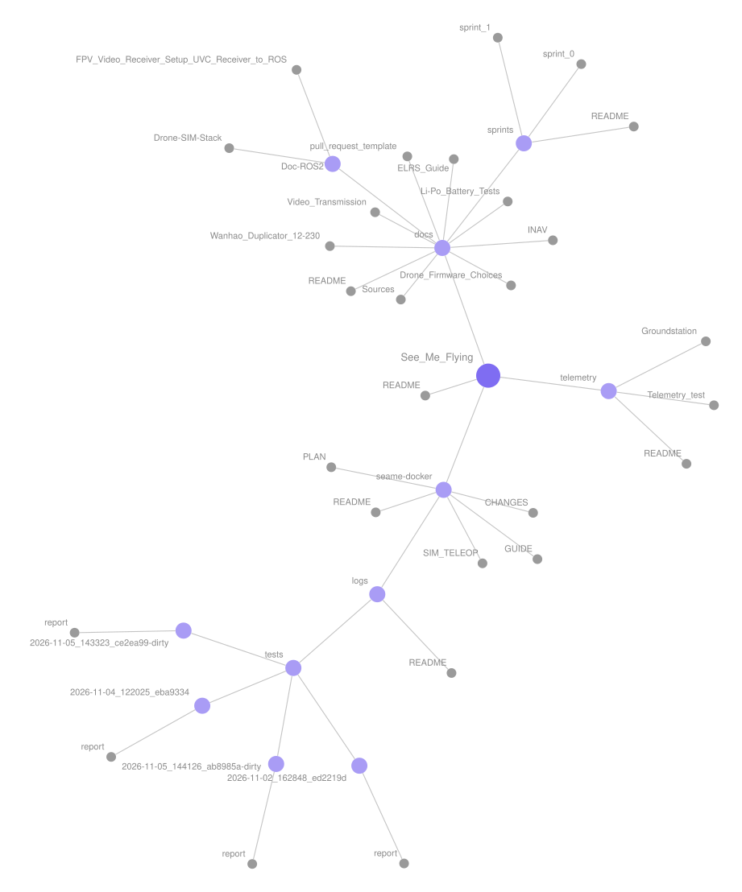

# See Me Flying: Autonomous Indoor Drone

SEA:ME 2.0 drone track · Team 4 · Milestone 1: *Architecture, real-time control & simulation* · updated **Nov 13, 2026** (commit `9cb07e9`)

An indoor drone that flies itself in a room of at most 10 × 10 m, **without GPS**. The airframe is a Pilotix Brook 2.5" with an OddityRC F7 flight controller running **INAV**, which keeps it stable and holds altitude. A ground computer runs **ROS 2 Jazzy** and decides where to go, talking to INAV over **Wi-Fi** through an ESP-12 module. A **Gazebo** simulation stands in for the drone and is shaped like it: the same topics, the same limits, the same arming rules. Code tested in the sim should run on the real drone unchanged.

**How to read this page.** Sections 1–3 give the whole picture: status, quick facts, architecture and data flow. Section 4 goes topic by topic: what each part is, how it works today, what's expected of it, what it needs, where it's going, and what's still unknown. Sections 5–8 are the dependencies, the priorities, the questions to ask, and the work still to do. How every automated test works is in [docs/CI_How_It_Works.md](./docs/CI_How_It_Works.md).

## Contents

1. [Status at a glance](#1-status-at-a-glance)
2. [Quick reference](#2-quick-reference)
3. [Architecture and data flow](#3-architecture-and-data-flow)
4. [Each topic in depth](#4-each-topic-in-depth)
5. [Dependencies](#5-dependencies)
6. [Priorities](#6-priorities)
7. [Questions to ask](#7-questions-to-ask)
8. [What needs to be implemented](#8-what-needs-to-be-implemented)
9. [Getting started](#9-getting-started)
10. [Repository map](#10-repository-map)
11. [Where the details are, and which docs are stale](#11-where-the-details-are-and-which-docs-are-stale)
12. [Team, branches, contributing](#12-team-branches-contributing)
13. [Glossary](#13-glossary)

---

## 1. Status at a glance

| Area | State | What works today | What blocks the next step |
| --- | --- | --- | --- |
| Simulation stack | ✅ working | Takeoff, hold, relative Goto, Land, radio takeover, kill switch, failsafes; a nightly Gazebo flight test | nothing |
| Simulated sensors | ✅ new | Optical flow + rangefinder modelled on the MicoAir MTF-02P; **estimator v1** turns them into `fc/odom` (since Nov 13) | noise values are placeholders until bench data exists |
| Real drone hardware | ⚠️ partly ready | Assembled, INAV flashed and calibrated, arms from the radio on the bench, failsafe tested | arming tests **on hold** (a damaged motor wire); **no rangefinder fitted** |
| Radio, arming, failsafe | ✅ tested on the bench | Two-switch arming (ARM + PREARM), DROP after 0.5 s of radio loss | nothing |
| Wi-Fi link (ESP-12) | ⚠️ works, slow tail | MSP over esp-link: median 40–100 ms, but 1 reply in 20 takes over 0.75 s (max 1.6 s) | too slow and irregular for a fast control loop from the ground |
| Telemetry tool | ✅ working | `telemetry/inav_telemetry.py` reads 13 INAV messages; 140 tests against real recordings | nothing |
| ROS ↔ real drone (`fc_bridge` `inav` backend) | ❌ stub | The C++ MSP library is written and tested (ROS-6 step A) | **step B**: connect it; and the decision on how ROS commands INAV (below) |
| Commanding the real drone from ROS | ❌ not designed | — | INAV takes stick inputs, not velocities, and offers **no position-hold mode** on this drone today ([question 1](#7-questions-to-ask)) |
| Video | ✅ / ❌ | FPV camera into ROS as `/image_raw` | no perception node yet |
| CI | ✅ green at HEAD | 259 ROS cases + 140 telemetry cases pass (Nov 13); the Docker image builds; nightly Gazebo flight | `main` doesn't *require* CI yet; `fc_bridge` has no lint |

**In one sentence:** the simulated drone flies missions safely, and the real drone is safe on the bench and readable over Wi-Fi. The bridge between the two, ROS **commanding** the real drone, is the open problem, and it's a design decision before it's code.

---

## 2. Quick reference

| Item | Value |
| --- | --- |
| **`ROS_DOMAIN_ID`** | **`6`** for the team. Tests use their own: 196 (Gazebo flight), 198 (stack test), 199 (fc_bridge tests), all localhost only |
| ROS 2 | Jazzy, in the Docker container `seame-dev` (image `seame/ros2-dev:jazzy`, Ubuntu 24.04) |
| Simulator | Gazebo Harmonic via `ros_gz`. Drone: the X3 quadcopter with Gazebo's velocity controller. Worlds: Gazebo's `multicopter_velocity_control.sdf` (default), our `room_world.sdf` and `outdoor_field.sdf` |
| Flight controller | OddityRC F7 40A AIO (STM32F722RET6, 512 KB flash, 5 UARTs) |
| Firmware | INAV 9.1.x on a custom target `ODDITYRCF7AIO`. The firmware doc says 9.1.1; the drone reported **9.1.0** in the Nov 9 recordings ([question 9](#7-questions-to-ask)) |
| Wi-Fi bridge | ESP-12E/F (ESP8266) on **UART1** at 115200 baud, running **esp-link 3.2.47**, access-point mode: join the drone's Wi-Fi, then TCP **`192.168.4.1:23`** |
| Radio | RadioMaster Pocket (EdgeTX 2.12.4, internal ELRS 4.1.0) → BETAFPV Nano RX (ELRS 4.1.0, 2.4 GHz). ARM = CH5 (switch SD), PREARM = CH6 (button SE) |
| Sensors on the drone | accelerometer, gyro, barometer, temperature, **ThoneFlow-3901U optical flow** (UART). No compass, no GPS, **no rangefinder** (the MTF-02P is planned) |
| Video | Caddx Ratel 2 (analog) → PandaRC VT5804 VTX, 5.8 GHz → USB UVC receiver → `usb_cam` → `/image_raw` |
| Battery | 4S Li-Po (16.2 V charged in the recordings); INAV `vbat_scale` 1103 |
| Ground station | Raspberry Pi 5 (16 GB, AI HAT+, Raspberry Pi OS Lite) and team laptops |
| Agreed control targets (ALL 1.1) | control loop **50 Hz** (minimum 20 Hz), bridge watchdog **200 ms**. Implemented today: 20 Hz and 300 ms ([question 10](#7-questions-to-ask)) |

**Why domain 6.** The SEA:ME network is shared between teams. ROS 2 nodes only discover each other on the same `ROS_DOMAIN_ID`, so every machine and container on our team uses 6 and no other team may. It's the default in `seame-docker/compose.yaml`, `.env.example` and `make-env.sh`. On a machine running ROS outside Docker (the Pi), add `export ROS_DOMAIN_ID=6` to `~/.bashrc`. Check with `echo $ROS_DOMAIN_ID`.

---

## 3. Architecture and data flow

### 3.1 The physical system

```
 ┌──────────────────────── GROUND (ROS 2 Jazzy in Docker, domain 6) ─────────────────────────┐
 │  laptop or Raspberry Pi 5                                                                  │
 │                                                                                            │
 │  mission ─┐                                                                                │
 │  radio*  ─┼─► safety_manager ─► fc_bridge ─┬─ backend sim ──► ros_gz_bridge ──► Gazebo X3 │
 │  manual  ─┘   (picks one)      (clamps,    │                                               │
 │                                 timeout)   └─ backend inav ─► MSP over TCP (stub today)    │
 │  inav_telemetry.py ─────────────────────────────────────────► MSP over TCP (works today)   │
 │  usb_cam ◄── USB UVC receiver                                       │                     │
 └──────────────▲──────────────────────────────────────────────────────┼─────────────────────┘
                │ 5.8 GHz analog video                                 │ Wi-Fi (ESP's own access point)
 ┌──────────────┼────────────────────── DRONE ──────────────────────────┼────────────────────┐
 │  Caddx Ratel 2 ── VTX (UART3, IRC Tramp)                ESP-12 (esp-link, TCP :23)       │
 │                                                                      │ UART1, 115200      │
 │  ThoneFlow-3901U ── UART ──► OddityRC F7, INAV 9.1.x ◄───────────────┘                    │
 │  (MTF-02P planned)           attitude, baro altitude hold, failsafe ──► 4 ESCs ──► motors  │
 │                              ▲                                                            │
 │              ELRS receiver ──┘ CRSF                                                       │
 └──────────────▲────────────────────────────────────────────────────────────────────────────┘
                │ ELRS 2.4 GHz: sticks, ARM, PREARM. The only way to arm.
          RadioMaster Pocket
 * radio_teleop + joy_node exist in the sim only: there the Pocket is plugged in by USB as a joystick.
```

**Where the work happens.** INAV runs the fast loops (motor mixing, attitude stabilisation at kHz rates, altitude hold, failsafe) **on the drone**. ROS runs **on the ground** and decides what to do: take off, go 1 m forward, land, hand over to the pilot. ROS never runs on the drone. Everything ROS sends crosses the Wi-Fi link, so the link's delay is part of every decision ([3.6](#36-timing-budget-and-why-the-wi-fi-link-matters)).

### 3.2 The ROS graph (simulation, as `sim.launch.py` starts it)

```
                        actions: mission/takeoff, mission/goto, mission/land
                                          │
  demo_flight (demo:=true) ───────────────┤
                                          ▼
                                       mission ──────────── /cmd/mission ─────────┐
  setpoint_pub (source:=circle demo:=true) ── /cmd/mission ───────────────────────┤
  keyboard / ros2 topic pub ─────────────────── /cmd/manual ──────────────────────┤
  joy_node ── /joy ──► radio_teleop ─────────── /cmd/radio ───────────────────────┤
                         │ fc/arm (service)                                       ▼
                         │                                                 safety_manager ── /safety/active_source (latched)
                         ▼                                                        │ /fc/setpoint_velocity
                     fc_bridge ◄──────────────────────────────────────────────────┘
          fc/status, fc/range, fc/attitude │  ▲ fc/arm, fc/hold (services)
                                           │  │
              /X3/gazebo/command/twist, /X3/enable          /X3/odom
                                           ▼  │
                                     ros_gz_bridge ◄─── /clock, odometry ─── Gazebo (X3)
                                           │
                                           └── /sim/ground_truth ──► flow_model ── fc/optical_flow ──► estimator ── fc/odom ──► mission
                                                                                        ▲  fc/range, fc/attitude ─┘
```

### 3.3 The design rules

These rules run through the whole codebase, and most tests check one of them. Breaking one is a design change, not a bug fix.

| # | Rule | Why | Enforced by |
| --- | --- | --- | --- |
| 1 | **`fc_bridge` is the only node that commands the drone** (sim or real). It clamps every command and sends zero when commands go stale | One place for limits and failsafes, right before the motors | `test_failsafes.py` |
| 2 | **`safety_manager` is the only publisher of `/fc/setpoint_velocity`.** Every source publishes on its own `cmd/<source>` topic; the highest-priority fresh one wins: **radio > manual > mission** | The pilot can always take over a running mission, with no added delay | `test_arbiter.py`, `test_stack.py` |
| 3 | **Only the radio arms.** On the real drone ROS can't arm or disarm (`fc/arm` refused with `backend:=inav`). In the sim the radio arms through `fc/arm`; only with `radio:=false` does the mission arm itself | A software bug must never start the motors | `test_inav.py`, `test_radio_teleop.py`, `test_logic.py` |
| 4 | **Two failsafe layers.** ROS: fc_bridge sends zero velocity (hover) 0.3 s after the last fresh command. Drone: INAV disarms (DROP) after 0.5 s of radio loss; MSP RC override isn't enabled, so Wi-Fi can't keep the drone flying without the radio | Either side can fail alone | `test_failsafes.py`, `test_sim_flight.py` step 8, bench tests |
| 5 | **The sim reports state the way the real drone will.** Above `fc_bridge` nobody reads Gazebo's perfect pose: position comes from optical flow (it drifts), height from a rangefinder with limits, rates quantised like INAV's MSP. `/sim/ground_truth` is for grading tests only | Code must not come to rely on what the real drone won't have | `test_state.py`, `test_flow_model.py`, `test_estimator.py` |
| 6 | **Moves are relative.** `Goto` means "1 m forward from where you are now, in your current heading", never an absolute x, y | Optical-flow position drifts: fine over a few metres, useless for returning to a spot | `test_logic.py` |
| 7 | **Height comes from the rangefinder**, tilt-corrected, not from odometry z | Like INAV's surface mode; baro is too noisy indoors | `test_logic.py` |
| 8 | **Logic without ROS.** Each decision-making node keeps its logic in a plain Python class (`logic.py`, `arbiter.py`, `estimator.py`, `flow_model` functions) and a thin ROS wrapper | Whole flights are tested in milliseconds, with no timing flakiness | the 99 logic tests |
| 9 | **Switching sim ↔ real is one launch argument** (`backend:=sim\|inav`), never a different node graph above `fc_bridge` | What's tested in the sim is what flies | `test_launch_files.py` |

### 3.4 How the data flows

**a) Commands, sim (works today):**

```
 source ──► /cmd/<source> ──► safety_manager ──► /fc/setpoint_velocity ──► fc_bridge ──► /X3/gazebo/command/twist ──► Gazebo
  20 Hz      TwistStamped,      forwards at       TwistStamped               ticks 20 Hz:      geometry_msgs/Twist
             frame base_link    once (no delay)   base_link                  fresh (< 0.3 s)?  body frame
                                if it's the                                  → clamp, send
                                highest fresh                                stale/NaN/hold?
                                source                                       → send zero
```

- **Units and frame:** m/s and rad/s in the body frame `base_link` (x forward, y left, z up; positive yaw rate = turn left). Only `linear.x/y/z` and `angular.z` are used; roll and pitch rates are forced to 0.
- **Clamp:** horizontal speed ≤ 0.5 m/s (direction kept), vertical ≤ 0.3 m/s, yaw rate ≤ 1.0 rad/s.
- **Silence is meaningful.** The mission publishes nothing while grounded. The radio publishes only while engaged. A source that stops lets the next one take over after 0.3 s, and with no source left, fc_bridge hovers.

**b) State, sim (works today):**

```
 Gazebo X3 odometry (50 Hz) ──ros_gz_bridge──┬──► /X3/odom ──────────► fc_bridge ──► fc/range     (tilt-aware, MTF-02P limits, ±inf out of range)
                                             │                                   └──► fc/attitude  (quaternion)
                                             │                                   └──► fc/status    (1 Hz + on change)
                                             └──► /sim/ground_truth ──► flow_model ──► fc/optical_flow (rad/s, whole °/s, quality 0/255)
                                                                                            │
                         fc/range + fc/attitude + fc/optical_flow ──► estimator ──► fc/odom (position integrated from flow, height from range)
                                                                                            │
                                             mission ◄── fc/range, fc/odom, fc/status, safety/active_source
```

**c) State and commands, real drone (planned; ROS-6 step B):**

```
 fc_bridge (backend:=inav) ──TCP──► esp-link :23 ──UART1──► INAV
    polls: MSP2_INAV_STATUS, MSP_ATTITUDE, MSP_SONAR_ALTITUDE, MSP2_INAV_OPTICAL_FLOW,
           MSP2_INAV_ANALOG, MSP2_INAV_FULL_LOCAL_POSE, …   (decoders done and tested in fc_msp)
    publishes: the same fc/status, fc/attitude, fc/range, fc/optical_flow (+ fc/battery, new)
    commands: NOT DECIDED. Likely MSP_SET_RAW_RC under INAV's "MSP RC OVERRIDE" mode,
              switched on by the pilot's takeover switch; never the ARM channel (INAV-6)
```

**d) Telemetry today (outside ROS):** `python3 telemetry/inav_telemetry.py --port 23` on a computer on the drone's Wi-Fi: request → reply for each of 13 messages, printed or logged as JSON lines. Read-only.

**e) Arming:** real: Pocket → ELRS → INAV (ARM on CH5 needs PREARM on CH6 within 3 s); nothing else can arm. Sim: the Pocket by USB → `joy_node` → `radio_teleop` → `fc/arm` → fc_bridge → `/X3/enable`.

**f) Video:** camera → VTX → 5.8 GHz → USB receiver (`/dev/videoN`) → `usb_cam` → `/image_raw` at about 25 Hz. Nothing consumes it yet.

**g) Time:** in the sim every node runs on Gazebo's `/clock` (`use_sim_time: true`), so a slow simulation is just slow, never wrong. With `backend:=inav` it's the wall clock.

### 3.5 The interface contract

Everything above `fc_bridge` depends only on these names. Changing one means changing every user and its tests.

| Name | Kind · type | From → to | Rate | Notes |
| --- | --- | --- | --- | --- |
| `/cmd/mission`, `/cmd/manual`, `/cmd/radio` | topic · `geometry_msgs/TwistStamped` | sources → safety_manager | 10–20 Hz while active | sensor-data QoS on the subscriber |
| `/fc/setpoint_velocity` | topic · `TwistStamped`, `base_link` | safety_manager → fc_bridge | as the active source | NaN/inf rejected; stale after 0.3 s |
| `/safety/active_source` | topic · `std_msgs/String` | safety_manager → mission | on change, latched | `radio`, `manual`, `mission` or `none` |
| `fc/status` | topic · `drone_interfaces/FcStatus` | fc_bridge → all | 1 Hz + on change | backend, armed, holding, following_setpoints, setpoint_age_s, range_valid |
| `fc/range` | topic · `sensor_msgs/Range` | fc_bridge | 50 Hz (sim) | REP 117: `+inf` beyond max, `-inf` below min |
| `fc/attitude` | topic · `geometry_msgs/QuaternionStamped` | fc_bridge | 50 Hz (sim) | |
| `fc/optical_flow` | topic · `drone_interfaces/OpticalFlow` | flow_model (sim), fc_bridge (real, planned) | 50 Hz (sim) | rad/s; forward flight → negative `flow_rate_y` |
| `fc/odom` | topic · `nav_msgs/Odometry`, `odom` → `base_link` | estimator (sim) | 50 Hz (sim) | position drifts by design; fc_bridge can also publish it (`publish_odom`) |
| `fc/battery` | topic · `sensor_msgs/BatteryState` | nobody yet | — | safety_manager only warns below 20 % |
| `fc/arm`, `fc/hold` | services · `std_srvs/SetBool` | radio_teleop, mission → fc_bridge | on demand | `fc/arm` refused on the real drone |
| `mission/takeoff`, `mission/goto`, `mission/land` | actions · `drone_interfaces/action/*` | any client → mission | one goal at a time | see [4.11](#411-mission-and-demo_flight) |
| `/sim/ground_truth` | topic · `Odometry` | Gazebo (and `fake_drone` in tests) | 50 Hz | tests and the flow model only, never the estimator |

### 3.6 Timing budget, and why the Wi-Fi link matters

| What | Value | Source |
| --- | --- | --- |
| fc_bridge command tick | 20 Hz | `sim.yaml` |
| Command timeout (fc_bridge, safety_manager) | 0.3 s | `sim.yaml` (ALL 1.1 agreed 200 ms) |
| Mission command rate | 20 Hz while airborne | `sim.yaml` |
| Mission gives up on range / odometry | after 0.5 s; hovers 2 s waiting for range, then lands blind | `sim.yaml` |
| INAV radio-loss failsafe | DROP after 0.5 s | INAV config |
| **MSP round trip over Wi-Fi** (Nov 12, esp-link, AP mode, 500 samples) | **median 40 ms (bench) / 100 ms (cage); p95 ≈ 0.8 s; max 1.6 s; loss 0–1 %** | [telemetry/Telemetry_test.md](./telemetry/Telemetry_test.md) |
| One MSP message polled alone (Nov 9) | 5–14 replies/s | [captures README](./telemetry/inav/captures/README.md) |
| All 9 live messages in turn | **1.4 cycles/s** | same |

**What this means.** The sim's link is instant; the real one isn't. With one request in flight at a time, the ground sees the drone's state a few times a second, and 1 reply in 20 is late by most of a second, longer than the 0.3 s command timeout. A ground-side loop at 20–50 Hz that waits for each reply can't work on this link as it is. Fast loops have to stay on INAV, and ROS should send slow, tolerant commands. The alternative is to make the link faster (fewer polled messages, pipelined requests, a different bridge, UDP). That's the core of [questions 1–4](#7-questions-to-ask) and [priority P1](#6-priorities). *This is an assessment from the measurements, not a team decision yet.*

---

## 4. Each topic in depth

Every topic follows the same pattern: **What it is · How it works today · Expected · Needed · Future · Open questions.**

### 4.1 Airframe and electronics

- **What it is.** Pilotix Brook 2.5" cinewhoop (carbon frame, prop guards, high-KV motors), as delivered, plus what the team added: optical flow sensor, ESP-12 Wi-Fi module, 3D-printed mounts.
- **How it works today.**
  - Flight controller: OddityRC F7 40A AIO, 4-in-1 ESC on board (Bluejay, DSHOT300, 12-pole motors, props-out).
  - UARTs (5): UART1 = ESP-12 (5 V, MSP 115200); UART3 = VTX (IRC Tramp); one for the ELRS receiver (CRSF); the ThoneFlow is planned on UART4 (3.3 V) per the Sprint 0 wiring plan; UART6 free. Wiring diagram: [docs/extras/wire_diagram.png](./docs/extras/wire_diagram.png).
  - The original TBS Crossfire receiver was replaced by a BETAFPV Nano RX (ELRS), because the project needed an open protocol.
  - Mounts modelled in Blender, printed on the lab's Wanhao Duplicator 12/230 with PrusaSlicer: the ESP-12 mount replaces the GoPro mount; the PMW3901 mount screws under the frame, notch pointing back. STLs in [docs/3D Print Files/](./docs/3D%20Print%20Files/).
  - Battery: 4S Li-Po. Voltage reading calibrated against a charger and multimeter (`vbat_scale` 1103, Oct 28).
- **Expected.** Safe indoor flight at ≤ 0.5 m/s, carrying the ESP and a downward sensor, for the length of a test.
- **Needed now.**
  - Repair or replace the motor with the **damaged wire** (one copper strand cut near the coils). Arming tests are on hold until then. Use a right-angle USB-C cable so the cable stops pressing on it.
  - A **rangefinder.** INAV only uses optical flow together with a valid rangefinder reading, so indoors without one there's no flow-based position or height. The sim already models the **MicoAir MTF-02P** (rangefinder 0.02–6 m + optical flow on one board). PLAN.md notes that "the decision isn't ours".
  - An EdgeTX alarm on RxBt below 14.0 V (the battery beeper can't be heard over the motors).
- **Future.** If the MTF-02P is fitted, it may replace the ThoneFlow. Battery life is short (high-KV motors), so plan tests in short flights.
- **Open questions.** Is the MTF-02P coming, and when? Does it replace the ThoneFlow or join it (UART budget)? Which UART does each device use in the final wiring?

### 4.2 Flight controller firmware: INAV

- **What it is.** Open-source flight-control firmware. Chosen over ArduPilot (needs ≥ 1 MB flash; this chip has 512 KB) and Betaflight (no autonomous modes, no optical-flow position hold). Reasoning: [docs/Drone_Firmware_Choices.md](./docs/Drone_Firmware_Choices.md).
- **How it works today.**
  - Custom target `ODDITYRCF7AIO`, derived from `AOCODARCF722AIO`: gyro alignment CW180 → CW90, LEDs on PA14/PA13, sensor scale 250 → 179. A gyro bug in the 9.1.0 base target was found by comparing branches.
  - Accelerometer calibrated (gains X 4096, Y 4098, Z 4095); board alignment fixed from the Sensors tab.
  - Sensors INAV detects (recordings): acc, baro, **optical flow**, temperature.
  - **Flight modes this drone offers** (from its `MSP_BOXNAMES` reply): ARM, PREARM, ANGLE, HORIZON, HEADING HOLD, **NAV ALTHOLD**, MC BRAKING, FAILSAFE, **MSP RC OVERRIDE**, TURTLE, BLACKBOX, beeper, OSD, camera and gimbal modes and others (31 in all). MSP RC OVERRIDE is offered by the firmware but not assigned to a switch, so Wi-Fi can't fly the drone today. **No NAV POSHOLD, no RTH, no waypoint mode**: INAV only lists position modes when it has a usable position source, and with no GPS and no rangefinder this drone has none.
  - Failsafe: DROP after 0.5 s of radio loss; re-arming needs the ARM switch cycled.
  - Backups: [docs/extras/Drone_INAV_Backup_26_10_26.txt](./docs/extras/Drone_INAV_Backup_26_10_26.txt) (current `diff all`), [Drone_Betaflight_Backup.txt](./docs/extras/Drone_Betaflight_Backup.txt) (original, fallback). Firmware build: [ODDITYRCF7AIO_inav_9.1.0_v2.zip](./docs/extras/ODDITYRCF7AIO_inav_9.1.0_v2.zip).
- **Expected.** INAV stabilises the drone and holds altitude and position, while ROS gives high-level setpoints.
- **Needed.** A position source INAV accepts (optical flow + rangefinder), then confirm NAV POSHOLD appears and holds indoors. The INAV settings for optical flow (`opflow_hardware`, scale, alignment) and for dead reckoning must be checked against the sensor actually fitted.
- **Future.** INAV-6: write commands (MSP RC override) with safety limits. An INAV upgrade (10.x) removes MSP messages the tools no longer poll (`MSP_STATUS`, `MSP_STATUS_EX`, `MSP_ANALOG`).
- **Open questions.** 9.1.0 or 9.1.1 on the drone? Will POSHOLD show up with flow + rangefinder on this build, or does it need `inav_allow_dead_reckoning` or similar? Which mode will ROS fly in (ANGLE + ALTHOLD, or POSHOLD)?

### 4.3 Radio, arming and failsafe

- **What it is.** RadioMaster Pocket (EdgeTX 2.12.4) with internal ELRS 4.1.0, bound to the drone's ELRS receiver. The pilot's control, and the **only** way to arm. Guide: [docs/ELRS_Guide.md](./docs/ELRS_Guide.md).
- **How it works today.**
  - Sticks on CH1–4 in AETR order. **ARM** on CH5 from switch **SD**; **PREARM** on CH6 from the momentary button **SE**: hold SE, flip SD within 3 s (`prearm_timeout = 3000`).
  - Tested on the bench: kill switch stops the motors at once; PREARM timeout refuses arming; ARM switch already on at power-up must be cycled; radio loss → DROP and stays disarmed.
  - **In the sim** the Pocket is a USB joystick (`joy_node` → `radio_teleop`), using a separate EdgeTX model "INAV-SIM" with Internal RF **off**, so it can never command a real drone on the bench. There, switch **SA** (axis 4) arms through `fc/arm`, and a separate **takeover** switch (axis 6) hands the sticks control over a running mission. Arm alone flies nothing: the radio is "ready" while the mission flies.
- **Expected.** The pilot can take over or kill the motors at any moment, on the real drone and in the sim alike.
- **Needed.** On the real drone, an equivalent of the sim's takeover switch: most likely the switch that turns INAV's MSP RC OVERRIDE mode on and off (the `radio_teleop` docstring describes this). The sim (SA + takeover) and the real radio (SD + SE) use different switches; align them so pilots build one habit.
- **Future.** Failsafe behaviour for **Wi-Fi** loss (as opposed to radio loss) once ROS commands the drone.
- **Open questions.** Which physical switch will be the takeover on the real drone? What does INAV do when MSP RC override is on and MSP commands stop arriving? It should fall back to the radio's sticks, and the timeout must be confirmed.

### 4.4 The Wi-Fi link (ESP-12) and MSP

- **What it is.** An ESP-12E/F (ESP8266) on UART1 that turns the FC's serial port into a TCP socket. The ground speaks **MSP v2** (MultiWii Serial Protocol) through it: one request, one reply; INAV never sends anything unasked. Primer: [docs/Msp_primer.md](./docs/Msp_primer.md).
- **How it works today.**
  - Firmware **esp-link 3.2.47**, chosen over MicroPython after latency tests (esp-link AP: about 9–15 ms average in clean runs; MicroPython AP: about 90 ms). See [telemetry/Telemetry_test.md](./telemetry/Telemetry_test.md).
  - **AP mode**: the ESP makes its own network and the ground computer joins it (`192.168.4.1`, TCP port 23). Station mode (ESP joins the lab Wi-Fi, useful for SSH to the Pi) adds about 40–60 ms.
  - Measured Nov 12 (bench and cage, power saving off): median 40 / 100 ms, p95 ≈ 0.8 s, max 1.6 s, loss 1 % / 0 %, no corrupted frames. Replies fall in two groups (0–40 ms and 140–180 ms), as if the link switches between a fast and a slow mode.
  - During the Nov 9 recordings about 20 % of requests timed out, and long replies (`MSP_BOXNAMES`, 368 bytes) often arrived cut short.
  - The messages to use are chosen and documented field by field: [telemetry/candidatesList.md](./telemetry/candidatesList.md) (INAV-4).
- **Expected (ALL 1.2).** TCP during bring-up (reliability and easy debugging matter more than latency). For control, "a late command is worse than a lost one", so control traffic was planned to move to UDP. The telemetry doc argues against UDP: esp-link's UDP would need client code on the micro-controller.
- **Needed.** A link budget that fits the control design: which messages, how often, how late at worst. Then measure it again from the machine that will fly (the Pi), with the radio on.
- **Future.** Pipelined requests (several in flight, matched by command ID), a higher UART baud rate, or a different bridge firmware if the tail can't be tamed.
- **Open questions.** TCP or UDP, finally? What causes the 0.8 s tail: Wi-Fi power saving, TCP delayed ACKs (`latency_test.py --quickack` exists to compare), or esp-link buffering? Can the UART run faster than 115200? Which ESP firmware is the reference (several docs still say MicroPython, see [section 11](#11-where-the-details-are-and-which-docs-are-stale))?

### 4.5 Telemetry tools (`telemetry/`)

- **What it is.** Plain Python (standard library only) for reading the real drone, outside ROS.
- **How it works today.**
  - [inav_telemetry.py](./telemetry/inav_telemetry.py): asks for identity once (API version, variant, version, board, name, mode names), then polls 13 live messages in a loop. Output is readable text (default) or `--info` JSON lines, and `--log` saves them. A message INAV rejects is dropped from the loop. Rates: `--rate 5` cycles/s, `--timeout 0.4` s per reply.
  - [latency_test.py](./telemetry/latency_test.py): round-trip time and loss, one CSV row per sample. `seame-docker/logs/measurements/measure_wifi_rtt.py` wraps it and keeps a history.
  - [inav/captures/msp_inventory.py](./telemetry/inav/captures/msp_inventory.py): `capture` records raw replies per drone state (the test recordings); `rate` measures replies per second per message.
  - Every field and unit: [telemetry/README.md](./telemetry/README.md). Recordings and their meaning: [captures README](./telemetry/inav/captures/README.md).
  - Tested on every push: 140 cases against hand-built and **recorded** frames ([CI doc, section 4](./docs/CI_How_It_Works.md#4-telemetry-tests-job-telemetry-python)).
- **Gotcha.** The default port in `inav_telemetry.py` and `latency_test.py` is **5760**, which belongs to the old MicroPython bridge. With esp-link pass **`--port 23`**.
- **Expected.** A trustworthy way to see what INAV sees, before ROS does.
- **Needed.** Fix the default port; one shared MSP module instead of three copies of the CRC and frame builder; new recordings once the radio is bound and a rangefinder is fitted.
- **Future.** These tools are the reference for fc_bridge's C++ decoders, and they'll double as a bench check (A6: run the recording checks live before each flight session).
- **Open questions.** Does INAV 9.1.0 really send negative optical-flow rates as 0? (The C++ decoder notes that no recorded rate is ever negative.) If so, MSP flow is only half usable, and ROS should read INAV's own position estimate instead.

### 4.6 Development environment (Docker)

- **What it is.** One Docker image (`seame-docker/Dockerfile`, from `ros:jazzy`) so every laptop runs the same ROS 2, Gazebo and tools. Setup guide: [seame-docker/GUIDE.md](./seame-docker/GUIDE.md).
- **How it works today.**
  - `compose.yaml` starts container `seame-dev` with **host networking** (DDS discovery across machines), host IPC (Fast DDS shared memory), X11 for Gazebo's window, `/dev/dri` for the GPU, `/dev/input` and `/dev` for the radio and the video receiver, cgroup rules so a replugged radio works, and the named volume `gz-cache` for downloaded Gazebo models.
  - `./ros2_ws` is **mounted** at `/home/dev/ros2_ws`. Edit on the host; build inside. `build/` and `install/` live on the host and survive `docker compose down/up`, so they also **go stale**: after a pull, rebuild ([section 9](#9-getting-started)).
  - The container's user `dev` gets your host UID/GID (from `.env`), so files you create are yours.
  - [start.sh](./seame-docker/start.sh): starts the container if needed (creating `.env`), then offers a menu: smoke test, Gazebo with keyboard, Gazebo with the Pocket, shell.
- **Expected.** Any team laptop (Ubuntu 22.04–26.04, Arch) gets a working environment in one build. CI proves the image still builds (`docker-image` job).
- **Needed.** Docker **Engine**, not Docker Desktop (Desktop's VM breaks host networking and therefore ROS discovery).
- **Future.** The Pi runs the tools natively (no desktop, no sim).
- **Open questions.** Should the launch scripts run `colcon build` first, so a stale workspace can't happen after a pull? It's a few seconds per launch.

### 4.7 Simulation: Gazebo, worlds and the bridge

- **What it is.** Gazebo Harmonic, a physics simulator, running the X3 quadcopter, which has a built-in **velocity controller**: give it a body-frame velocity and it works out motor speeds and holds it. `ros_gz_bridge` copies the few topics we need between Gazebo and ROS.
- **How it works today.**
  - `sim.launch.py` arguments: `backend` (sim | inav), `source` (mission | circle | none), `radio` (true | false), `demo` (false | true), `world` (file or name in `drone_bringup/worlds/`), `headless` (true = server only, for CI). Before starting anything it checks every package exists and that no other Gazebo runs in your `GZ_PARTITION` (two sims would share topics and the drone would "flicker").
  - Bridge ([gz_bridge.yaml](./seame-docker/ros2_ws/src/drone_bringup/config/gz_bridge.yaml)): ROS → Gazebo `/X3/gazebo/command/twist`, `/X3/enable`; Gazebo → ROS `/clock`, and the X3's odometry twice: as `/X3/odom` (fc_bridge's input) and `/sim/ground_truth` (tests and flow model only).
  - Worlds: Gazebo's `multicopter_velocity_control.sdf` (default; X3 and X4, only X3 used), [room_world.sdf](./seame-docker/ros2_ws/src/drone_bringup/worlds/room_world.sdf) (a model of the lab room, with tables; has an IMU sensor system loaded), [outdoor_field.sdf](./seame-docker/ros2_ws/src/drone_bringup/worlds/outdoor_field.sdf) (grass). Models in `drone_bringup/models/`. Room mesh source: [roomodel/room.stl](./roomodel/room.stl).
  - Measured in the sim: commands are in the body frame (forward follows the nose within 1°); the controller holds zero vertical *speed*, not a height, so the drone sags about 1 cm every 6 s (the mission corrects it).
- **Expected.** Sprint 2's theme: **reduce the gap between the sim and the real drone**. That means sensor values and delays like the real ones, and better CAD models.
- **Needed.**
  - **Link delay and loss** in the sim, between fc_bridge and Gazebo, drawn from the Nov 12 measurements.
  - A **command interface like INAV's**. The X3 takes velocities; the real drone will take stick values interpreted by an INAV mode. Until the real command path is decided, the sim is optimistic here.
  - An IMU on the drone model (`fc/imu`), when something needs it.
- **Future.** Fly the nightly test in every world (D2); fake radio input in the sim (D3); namespaces for several drones (Module 3).
- **Open questions.** Should the sim model INAV's stick-to-velocity behaviour (or run INAV SITL as the flight controller in the loop)? Is the room world the default for testing now?

### 4.8 Sensors and state estimation

- **What it is.** How the drone knows its height, speed and position without GPS: a **downward optical-flow camera** (how fast the floor slides past, in angle per second) and a **rangefinder** (height). Speed ≈ flow × height, so flow is useless without height. Explanation: [docs/Doc-ROS2/SIM_Sensors.md](./docs/Doc-ROS2/SIM_Sensors.md).
- **How it works today (sim).**
  - **Rangefinder** in fc_bridge: distance along the body's down axis (longer when tilted), MTF-02P limits 0.02–6.0 m, 4° cone, noise 1 cm (placeholder), `±inf` out of range.
  - **`flow_model`** (`drone_sim_sensors`): optical flow from Gazebo's truth, like `MSP2_INAV_OPTICAL_FLOW`: quality 255 (or 0 below 8 cm or above 7 rad/s), noise 0.01 rad/s (placeholder), **truncated to whole °/s** as INAV's MSP sends them. Measured with `flow_check`: speed right within about 1 cm/s at 1 m. Rounding means motion slower than about 1.7 cm/s (at 1 m) doesn't show at all, so a hovering drone can creep up to about 1 m/min unseen.
  - **`estimator`** v1 (new Nov 13): velocity = flow × range (minus body rotation), height = range × tilt correction, vertical speed from a 0.6 s line fit, position integrated in the world frame; holds the last speed 0.3 s after flow is lost, then assumes stopped. Publishes `fc/odom`. fc_bridge's own flow-like odometry still exists (`publish_odom: true`), but `sim.yaml` turns it off.
- **How it works on the real drone.** INAV reads the ThoneFlow itself (`CXOF`-style UART flow) and fuses it with its IMU, but only with a rangefinder. Over MSP the ground can read raw flow (`MSP2_INAV_OPTICAL_FLOW`) and INAV's own estimate (`MSP2_INAV_FULL_LOCAL_POSE`, which reads 0 on the bench with no estimate).
- **Expected.** A height good to a few cm (hold ±5 cm at 1.2 m) and a velocity good enough for metre-scale relative moves.
- **Needed.** Bench data for the real noise of flow and range, to replace the placeholders. A recording sliding the drone in **both** directions, to settle the negative-flow question.
- **Future.** Fuse the IMU; compare our estimator with INAV's in flight. An absolute reference (markers, the camera) if missions ever need to come back to a spot.
- **Open questions.** **Who estimates position on the real drone: INAV (onboard, fast, uses its IMU) or our estimator (ground, at the link's few Hz)?** The estimator's docstring leaves both open. The link budget favours INAV.

### 4.9 `fc_bridge`: the only commander

- **What it is.** C++ node, package `drone_fc_bridge`, file [src/fc_bridge.cpp](./seame-docker/ros2_ws/src/drone_fc_bridge/src/fc_bridge.cpp). The boundary between "our software" and "the flight controller", sim or real.
- **How it works today.**
  - Parameter `backend`: `sim` or `inav`; anything else stops it at start.
  - Every tick (20 Hz): fresh setpoint (≤ 0.3 s, not from the "future" after a sim reset) and not holding → clamp and send; otherwise **send zero**. Gazebo keeps following the last command it got, so the explicit zero is the failsafe. Logs only on changes.
  - Rejects NaN/inf setpoints without refreshing the timer, so bad input times out.
  - Services `fc/arm` (sim: drives `/X3/enable`; inav: refused) and `fc/hold` (send zero whatever arrives). `fc/status` 1 Hz + on change.
  - Sim state from `/X3/odom`: `fc/range`, `fc/attitude`, optionally `fc/odom`. Noise with a fixed seed (42), so runs repeat.
  - `backend:=inav` today: same topics and services, sends nothing, publishes no state, refuses arming, creates **no** Gazebo publishers.
  - **`fc_msp` library** (ROS-6 step A, João): MSP v2 framing ([msp.hpp](./seame-docker/ros2_ws/src/drone_fc_bridge/src/msp.hpp)) and nine INAV decoders in SI units ([inav_decode.hpp](./seame-docker/ros2_ws/src/drone_fc_bridge/src/inav_decode.hpp)). It can build **only** the nine read commands (writes such as `MSP_SET_RAW_RC` are refused), recovers good replies from damaged streams, and has a bounded buffer. Tested with 37 C++ cases against the real recordings. **Not linked into fc_bridge yet.**
- **Expected.** On the real drone: publish the same `fc/*` state from MSP, and turn `fc/setpoint_velocity` into whatever INAV accepts, with every limit and failsafe still here.
- **Needed (ROS-6 step B).**
  1. A TCP client with reconnect, request timing (latency belongs here, STK-5), and `skip_pending()` on timeout.
  2. Read path: `MSP2_INAV_STATUS` → `fc/status` (armed comes from INAV now), `MSP_ATTITUDE`/local pose → `fc/attitude`, `MSP_SONAR_ALTITUDE` (only when the rangefinder bit is set) → `fc/range`, flow → `fc/optical_flow`, `MSP2_INAV_ANALOG` → `fc/battery`. Convert INAV axes to ROS (INAV: pitch positive nose-down, yaw a clockwise compass heading, NEU frame).
  3. A **fake flight controller** test (a TCP server replaying recordings), before touching hardware.
  4. Then the write path (INAV-6), behind its own safety limits, once [question 1](#7-questions-to-ask) is answered.
- **Future.** fc_bridge's rangefinder defaults (VL53L1X-like 0.04–4 m) should follow the sensor actually chosen; lint for this package.
- **Open questions.** How does a velocity become an INAV command (stick mapping, mode, rate)? What does fc_bridge do when MSP replies stop: hold, or nothing (INAV's own failsafe takes over)? Keep the 0.3 s timeout, or the agreed 200 ms?

### 4.10 `safety_manager`: who has control

- **What it is.** Python node, package `drone_safety`. Logic in [arbiter.py](./seame-docker/ros2_ws/src/drone_safety/drone_safety/arbiter.py), node in [safety_manager.py](./seame-docker/ros2_ws/src/drone_safety/drone_safety/safety_manager.py). Grew out of the old `watchdog`.
- **How it works today.** Subscribes `cmd/radio`, `cmd/manual`, `cmd/mission`. The highest-priority source that published in the last 0.3 s is active; its commands are forwarded **as they arrive** (no extra delay); others are dropped. With none active nothing is forwarded, so fc_bridge's timeout hovers the drone. The active source is latched on `safety/active_source` and logged on change. `fc/battery` below 20 % only logs a warning (nothing publishes it yet).
- **Expected.** The pilot always wins, instantly; a dead source never leaves the drone flying its last command.
- **Needed.** A real low-battery action (land), once fc_bridge publishes `fc/battery`. Altitude hold for manual and radio flight (today only the mission corrects the sim's sag).
- **Future.** More sources (perception-driven avoidance?) slot into `priority`.
- **Open questions.** What should low battery do: land in place, or refuse new goals? At what threshold for a 4S pack (INAV warns at 3.5 V/cell)?

### 4.11 `mission` and `demo_flight`

- **What it is.** Python package `drone_mission`: the autopilot "brain". Logic in [logic.py](./seame-docker/ros2_ws/src/drone_mission/drone_mission/logic.py) (state machine, no ROS), node in [mission.py](./seame-docker/ros2_ws/src/drone_mission/drone_mission/mission.py), scripted client [demo_flight.py](./seame-docker/ros2_ws/src/drone_mission/drone_mission/demo_flight.py).
- **How it works today.**
  - States: `grounded → takeoff → hold ⇄ goto → land → grounded`, plus `range_lost` and `overridden`.
  - **Takeoff** (`height`, 0 = 1.2 m): accepted on the ground, armed (by the radio unless `radio:=false`), with range readings steady for 1 s and a target below the rangefinder's max. Ends within 5 cm, or aborts and lands after 20 s.
  - **Goto** (`forward`, `left`, `yaw`, `speed`): relative to where it starts; accepted only while holding, with odometry. Ends within 10 cm and 0.05 rad; aborts when odometry stops or after twice the ideal time + 10 s. Feedback: distance and yaw remaining.
  - **Land**: accepted any time airborne; preempts everything; can't be cancelled. Touchdown = height below 0.12 m for 1 s, or commanding down without moving down (works blind).
  - **Height hold** in every airborne state: `vz = 1.0 × (target − height)`, limited to 0.3 m/s.
  - **Range lost** in flight: abort the goal, hover; back within 2 s → resume holding (never climbs on its own); otherwise land blind.
  - **Overridden** (another source active): abort the goal, go silent, refuse goals; when control returns, hold where the pilot left it, or stay grounded if landed or disarmed.
  - Single-threaded executor; `execute()` is a coroutine that awaits the next tick (the old multi-threaded executor stalled commands for up to 0.8 s: bug 3, fixed Nov 12).
  - `demo_flight`: takeoff, a 1 m square (forward + quarter turn left, ×4), land; retries Takeoff for 2 minutes until armed and the range is steady.
- **Expected.** Repeatable autonomous flights: takeoff to 1.2 m ± 5 cm, relative moves good to about 10 cm per metre, safe landing, pilot override at any time. Gazebo results: hover drift 0.000 m over 10 s, square sides 0.87–0.98 m, closes within 0.1 m.
- **Needed.** Re-measure with the estimator now providing `fc/odom`. Treat `-inf` *in the air* as a failing sensor, not as the ground (today it reads as height 0, so the mission would climb: listed "before hardware").
- **Future.** Waypoint lists or a goal queue; missions planned from perception; absolute positioning if markers are added.
- **Open questions.** Which missions does Milestone 1 have to show (square? room survey?)? Should the mission auto-disarm on the real drone, or always leave it to the pilot (today: the pilot)?

### 4.12 Pilots and the older sources

- **`radio_teleop` + `joy_node`** (sim only; package `drone_basics_py`): the Pocket as a USB joystick. Arm switch with a 0.1 s debounce (the switch bounces up to 35 ms, measured with [tools/arm_bounce.py](./seame-docker/ros2_ws/tools/arm_bounce.py)); refuses to arm with the throttle off centre or with the switch already on at start; takeover switch; sticks scaled to 0.5 / 0.3 / 1.0 with an 8 % deadband. `joy_node` opens the radio by name, so another gamepad can't be picked by mistake.
- **Manual** (`/cmd/manual`): `teleop_twist_keyboard` remapped there, or `ros2 topic pub`. Used by the nightly test to land after killing the mission.
- **`setpoint_pub`** (`drone_basics_py`): the first test source: climb 4 s, then circle forever. Kept for comparison (`source:=circle demo:=true`).
- **`watchdog`** (`drone_basics_cpp`, C++): logs when setpoints stop and resume, commands nothing. Only in `basics.launch.py`, the crash-course exercise.
- **Open question.** Retire `setpoint_pub`, `watchdog` and `basics.launch.py`, or keep them as teaching examples? (They have no tests.)

### 4.13 `drone_interfaces`

Custom message and action types ([msg/](./seame-docker/ros2_ws/src/drone_interfaces/msg/), [action/](./seame-docker/ros2_ws/src/drone_interfaces/action/)):
- `FcStatus`: backend, armed, holding, following_setpoints, setpoint_age_s, range_valid.
- `OpticalFlow`: quality, flow_rate_x/y, body_rate_x/y in rad/s, body frame, with the sign convention spelled out.
- Actions `Takeoff` (height), `Goto` (forward, left, yaw, speed), `Land`, each with result and feedback.

Services use the standard `std_srvs/SetBool`. **Expected:** stable; additions only. **Future:** `FcStatus` may grow fields from INAV (arming blockers, flight mode, link quality); decide before step B, since every subscriber recompiles.

### 4.14 Video and perception

- **How it works today.** The analog FPV camera goes out on 5.8 GHz; a USB UVC receiver on the ground shows up as `/dev/videoN`; `usb_cam` publishes `/image_raw` at about 25 Hz; view it with `rqt_image_view`. Guides: [docs/Doc-ROS2/FPV_Video_Receiver_Setup_UVC_Receiver_to_ROS.md](./docs/Doc-ROS2/FPV_Video_Receiver_Setup_UVC_Receiver_to_ROS.md), [docs/Video_Transmission.md](./docs/Video_Transmission.md).
- **Expected.** "A big source of information, used to guide the drone and tell it where it can go" (hardware doc).
- **Needed.** Nothing yet; no perception node exists. The Pi 5's AI HAT+ is the likely place for it.
- **Open questions.** What should perception do first: obstacle detection, visual markers for absolute position, or a target to follow? Which VTX channel is set? The docs disagree (band A ch1 5865 MHz vs R1 5658 MHz).

### 4.15 Tests and CI

Summary only. The full explanation is in **[docs/CI_How_It_Works.md](./docs/CI_How_It_Works.md)**.
- Every push and PR: `ros2-build-test` (259 cases in a clean `ros:jazzy`), `telemetry-python` (140 cases), `docker-image`; a failed PR goes back to draft (`block-red-pr`).
- Every night: a real Gazebo flight in 8 checked steps (`nightly.yml`).
- Locally: `./scripts/run_tests.sh` (kept in `seame-docker/logs/tests/`), `./scripts/sim_flight_test.sh`.
- Checks done by hand (hardware, Wi-Fi, sim flights watched by a person) and their last results: [docs/TESTS.md](./docs/TESTS.md).

### 4.16 Process: branches, PRs, logs, docs

- Work happens on branches and reaches `main` by pull request ([template](./docs/pull_request_template.md)); the most recent were #215 (tests) and #219 (room sim).
- Test runs are committed with the code they tested (`seame-docker/logs/tests/<date>_<commit>/`). A Claude Code hook ([.claude/hooks/check-test-run.sh](./.claude/hooks/check-test-run.sh)) stops a Claude-made commit of ROS code that has no test run.
- Measurements over time go to `seame-docker/logs/measurements/<name>/` with a `history.csv` ([logs/README.md](./seame-docker/logs/README.md)).
- Docs are an Obsidian vault (front matter `title:`, `# Tags` at the end).
- Sprint 2 (to Nov 15) plans: clean up old branches and merge ready features; start documenting tests; a better way to write docs ([Sprint 2 Planning.pptx](./Sprint%202%20Planning.pptx)).

---

## 5. Dependencies

### 5.1 Host

| Need | Why |
| --- | --- |
| Linux (Ubuntu 22.04–26.04 or Arch) | host networking for ROS discovery, X11 for Gazebo |
| Docker **Engine** + Compose plugin, your user in the `docker` group | **not** Docker Desktop: its VM breaks `network_mode: host` |
| GPU drivers on the host, user in `video`/`render` groups (`make-env.sh` writes the group IDs to `.env`) | Gazebo rendering; without them it falls back to software rendering (slow, but works) |
| Python 3 with `pytest` and `flake8` | only to run telemetry tests on the host (or use the container) |

### 5.2 Inside the image (`seame-docker/Dockerfile`)

`ros:jazzy` (Ubuntu 24.04) plus: `ros-dev-tools` (colcon, rosdep), `ros-jazzy-ros-gz` (Gazebo Harmonic + bridge), `ros-jazzy-joy`, `ros-jazzy-teleop-twist-keyboard`, `ros-jazzy-usb-cam`, `image-transport` (+ plugins), `cv-bridge`, `rqt-image-view`, `rqt-graph`, `tf2-tools`, `ament-mypy`, demo nodes, turtlesim, `v4l-utils`, `mesa-utils`, git, vim. **Add new apt packages to the Dockerfile**, not by hand in a running container: the next rebuild would lose them, and CI would never see them.

### 5.3 Our ROS packages and how they depend on each other

```
 drone_interfaces  (msg FcStatus, OpticalFlow; actions Takeoff, Goto, Land)
   ▲            ▲              ▲
   │            │              │
 drone_fc_bridge  drone_mission  drone_sim_sensors        drone_safety     drone_basics_py     drone_basics_cpp
 (C++: fc_bridge, (mission,       (flow_model,            (safety_manager) (radio_teleop,      (watchdog)
  fc_msp lib)      demo_flight)    estimator, flow_check)                   setpoint_pub)
   ▲                ▲              ▲                         ▲                ▲                   ▲
   └────────────────┴──────────────┴──── drone_bringup ──────┴────────────────┴───────────────────┘
                                         (launch files, sim.yaml, gz_bridge.yaml, worlds, models,
                                          system tests; also needs ros_gz_sim, ros_gz_bridge, joy)
```

| Package | Lang | External ROS dependencies |
| --- | --- | --- |
| `drone_interfaces` | IDL | std_msgs, action_msgs |
| `drone_fc_bridge` | C++17 | rclcpp, geometry_msgs, nav_msgs, sensor_msgs, std_msgs, std_srvs |
| `drone_mission` | Python | rclpy, geometry_msgs, nav_msgs, sensor_msgs, std_srvs |
| `drone_safety` | Python | rclpy, geometry_msgs, sensor_msgs, std_msgs |
| `drone_sim_sensors` | Python | rclpy, nav_msgs, sensor_msgs, geometry_msgs |
| `drone_basics_py` | Python | rclpy, geometry_msgs, sensor_msgs, std_srvs |
| `drone_basics_cpp` | C++ | rclcpp, geometry_msgs |
| `drone_bringup` | CMake (launch, config) | launch_ros, ros_gz_sim, ros_gz_bridge, joy, and every package above |

### 5.4 Outside ROS

| Thing | Depends on |
| --- | --- |
| `telemetry/*.py` | Python 3 standard library only (`termios`/`tty`, so Linux or macOS) |
| Gazebo's X3/X4 models | downloaded once from Gazebo Fuel (about 117 MB, pinned versions), kept in the `gz-cache` volume |
| INAV target and decoders | the INAV source at tag `9.1.0` (`msp_protocol.h`, `msp_protocol_v2_inav.h`, `fc_msp.c`, `runtime_config.h`) |
| Hardware tooling | INAV Configurator, EdgeTX Buddy, ExpressLRS configurator, `esptool` (flash esp-link), PrusaSlicer + Blender (mounts), `v4l-utils` + `ffmpeg` (video) |

---

## 6. Priorities

The order below is a **recommendation built from the repo**: the sprint plan, PLAN.md's "before hardware" items, the measurements and the code. The team's sprint board is the authority. The rule used: *first whatever blocks flying the real drone safely, then whatever makes the sim honest about it, then the rest.*

| # | Theme | Why now | First concrete step |
| --- | --- | --- | --- |
| **P0** | **Decide how ROS commands the real drone** | Everything real waits on it, and it's a design question, not code. INAV takes sticks, not velocities, and offers no position hold on this drone today | One meeting with INAV + ROS owners: answer questions 1–3; write the decision in PLAN.md |
| **P0** | **Rangefinder** | Without it INAV won't use optical flow, so there's no indoor position hold and no height for the mission | Confirm the MTF-02P (or alternative), fit it, re-record captures |
| **P1** | **Make the link fit the control design** | Median 40–100 ms is fine; the 0.8 s tail and the 1.4 Hz full-set rate aren't | Re-measure from the Pi with power saving off and the radio on; try `--quickack`; cut the polled set to what control needs; decide TCP/UDP |
| **P1** | **`fc_bridge` `inav` backend, read path** (ROS-6 step B) | The tested MSP library exists; connecting it is the shortest path to ROS seeing the real drone | TCP client + publish `fc/status`, `fc/attitude`, `fc/range`, `fc/battery`; fake-FC launch test |
| **P2** | **Hardware safety before props** | A damaged motor wire; no battery alarm; flow sign unknown | Fix the motor; add the RxBt alarm; record flow in both directions; bench checklist |
| **P2** | **Sim honesty** (the Sprint 2 theme) | The sim is optimistic on link, command interface and sensor noise | Delay/loss node in the sim; bench noise values in `sim.yaml`; rerun the nightly |
| **P3** | **`inav` backend, write path** (INAV-6) | Only after P0 and with P2 done | MSP RC override behind limits; never the ARM channel; tests against the fake FC |
| **P4** | **CI and process** | Cheap, prevents regressions | Required checks on `main`; lint `fc_bridge`; a nightly owner; branch cleanup |
| **P4** | **Docs consolidation** | Several docs contradict the code ([section 11](#11-where-the-details-are-and-which-docs-are-stale)) | Fix the list in section 11; fill Sprint 1–2 pages |
| **P5** | **Beyond Milestone 1** | Not blocking | Perception on `/image_raw`, low-battery landing, tf frames, multi-drone namespaces |

---

## 7. Questions to ask

The decisions this page couldn't settle from the repo, most blocking first. "Ask" names the area from the [team table](#12-team-branches-contributing).

| # | Question | Why it matters | Ask |
| --- | --- | --- | --- |
| 1 | **How will ROS command INAV?** MSP RC override (`MSP_SET_RAW_RC` while the "MSP RC OVERRIDE" mode is on)? Which channels (`msp_override_channels`, never ARM)? In which flight mode, so that sticks mean velocity? | Decides the whole write path, what fc_bridge turns `fc/setpoint_velocity` into, and what the sim should imitate | INAV, ROS |
| 2 | **What gives INAV a position hold indoors?** The drone offers NAV ALTHOLD but **no NAV POSHOLD** today. Will flow + rangefinder enable it on 9.1, or is a setting (dead reckoning) needed? | Without POSHOLD, ROS would have to close the position loop over a 1–2 Hz link | INAV |
| 3 | **Who estimates position on the real drone**: INAV onboard, or our `estimator` on the ground from MSP data? | The link budget (3.6) favours INAV; the sim currently uses ours | ROS, INAV |
| 4 | **What link budget do we design for?** Required rate and worst-case delay for commands and for state; TCP or UDP; UART faster than 115200? | ALL 1.1 asks 50 Hz; the link gives a few Hz with a 0.8 s tail | Stack, INAV |
| 5 | **Do negative optical-flow rates survive MSP on INAV 9.1.0?** No recorded rate is ever negative | If not, MSP flow is half usable, which reinforces question 3 | INAV |
| 6 | **Is the MTF-02P coming?** When, on which UART, and does it replace the ThoneFlow? | Rangefinder = no flow and no height without it; the sim already assumes it | Hardware |
| 7 | **Which switch is the takeover on the real radio**, and what does INAV do when override is on and MSP stops? | The pilot's override is a safety function; the sim uses SA + a takeover axis, the real drone SD + SE | INAV, ROS |
| 8 | **Wi-Fi loss failsafe**: when MSP commands stop, should the drone hover, land, or hand back to the sticks? Who triggers it (INAV or fc_bridge)? | Radio loss is covered (DROP); Wi-Fi loss isn't designed | ROS, INAV |
| 9 | **INAV 9.1.0 or 9.1.1 on the drone?** The doc says 9.1.1, the drone reported 9.1.0 | Decoders and the target were checked against 9.1.0 | INAV |
| 10 | **Command timeout 0.3 s or the agreed 200 ms?** | Two numbers in two places; the tests pin 0.3 | ROS |
| 11 | **Which ESP firmware is the reference**: esp-link (port 23) or MicroPython (port 5760)? | Tool defaults and three docs disagree | Stack |
| 12 | **Required CI checks on `main`**: who has admin, and who watches the nightly? | A red PR can still be merged; a failed nightly reaches one person | everyone |
| 13 | **What must Milestone 1 demonstrate**, and by when (Sprint 2 ends Nov 15)? | Sets which of P0–P3 must land first | team lead |
| 14 | **Root `TESTS.md` deletion**: final? Should old links point to [docs/CI_How_It_Works.md](./docs/CI_How_It_Works.md)? | Several docs link to a missing file | whoever deleted it |
| 15 | **What is perception for**, first: obstacles, markers for absolute position, a target? | Decides whether the camera feeds the mission or safety | team |

---

## 8. What needs to be implemented

Grouped by priority ([section 6](#6-priorities)). "Done when" is the check that closes it.

| # | Item | Where | Depends on | Done when | Pri |
| --- | --- | --- | --- | --- | --- |
| 1 | Command-path decision record (answers to questions 1–4, 7, 8) | `seame-docker/PLAN.md` or an ADR in `docs/` | — | written, agreed by INAV and ROS owners | P0 |
| 2 | Rangefinder fitted and configured in INAV | drone, INAV | question 6 | `MSP2_INAV_STATUS` shows the rangefinder bit; new recordings made | P0 |
| 3 | Link re-measured for the flying setup | `telemetry/latency_test.py`, `logs/measurements/wifi_rtt/` | — | a `wifi_rtt` run from the Pi, power save off, radio on, kept in history | P1 |
| 4 | Fix tool defaults (`--port 23`), one shared MSP module | `telemetry/` | question 11 | tools connect with no arguments; one CRC implementation | P1 |
| 5 | `inav` backend read path: TCP client, polling, decode, `fc/*` topics, `fc/battery`, axis conversion | `drone_fc_bridge` | `fc_msp` (done) | `ros2 topic echo /fc/attitude` follows the real drone on the bench | P1 |
| 6 | Fake flight controller (TCP server replaying recordings) + launch tests for 5 | `drone_fc_bridge/test/` | 5 | CI checks state, loss, late and damaged replies | P1 |
| 7 | Repair motor wire; RxBt alarm; bench checklist (props off, battery off after use) | drone, radio, `docs/` | — | arming tests resumed and passed | P2 |
| 8 | Flow recorded in both directions | `telemetry/inav/captures/` | — | question 5 answered with data | P2 |
| 9 | Link delay/loss model in the sim | new node or fc_bridge option | 3 | nightly flies with the measured delay distribution | P2 |
| 10 | Bench noise values for flow and range in `sim.yaml` | `drone_bringup/config/` | 2 | placeholders replaced, source noted | P2 |
| 11 | Mission: treat `-inf` in the air as a failure, not the ground | `drone_mission/logic.py` | — | a `test_logic.py` case | P2 |
| 12 | Re-measure the nightly with the estimator; add a flow-vs-truth step | `test_sim_flight.py` | — | numbers in the CI doc refreshed | P2 |
| 13 | `inav` backend write path (INAV-6) with limits | `drone_fc_bridge` | 1, 5, 6, 7 | fake-FC tests; bench test with props off | P3 |
| 14 | Low-battery action (land) | `drone_safety`, `drone_mission` | 5 | test with a fake `fc/battery` | P3 |
| 15 | Required status checks; `fc_bridge` lint; remove `Develop`, decide `staging` | GitHub settings, `ci.yml`, `CMakeLists.txt` | — | a red PR can't merge; lint green | P4 |
| 16 | Docs fixes from [section 11](#11-where-the-details-are-and-which-docs-are-stale); Sprint 1–2 pages | `docs/` | 14 | no doc contradicts the code | P4 |
| 17 | Optional: build before launch in `sim_keyboard.sh` / `sim_joy.sh` | `seame-docker/scripts/` | — | a pull can't leave a stale workspace | P4 |
| 18 | Perception node on `/image_raw` | new package | question 15 | defined by the question | P5 |
| 19 | IMU in the sim (`fc/imu`), tf frames aligned, namespaces per drone | sim, all nodes | — | when a consumer needs them | P5 |

---

## 9. Getting started

**Simulation, first time** (host, Linux, Docker Engine):

```bash
git clone https://github.com/SEAME-pt/See_Me_Flying.git
cd See_Me_Flying/seame-docker
./start.sh                      # creates .env (UID/GID, ROS_DOMAIN_ID=6, GPU groups), builds and starts the container, opens a menu
# or by hand:
./scripts/make-env.sh 6 && docker compose build && docker compose up -d
docker compose exec dev bash    # a shell inside; repeat for more terminals
```

Inside the container:

```bash
cd ~/ros2_ws
colcon build --symlink-install
source install/setup.bash
ros2 launch drone_bringup sim.launch.py radio:=false demo:=true   # no Pocket needed: watch the square
```

Fly it yourself (second terminal, `source install/setup.bash` first):

```bash
ros2 launch drone_bringup sim.launch.py radio:=false              # idle until a goal arrives
ros2 action send_goal --feedback /mission/takeoff drone_interfaces/action/Takeoff "{height: 1.0}"
ros2 action send_goal --feedback /mission/goto drone_interfaces/action/Goto "{forward: 1.0, speed: 0.3}"
ros2 action send_goal /mission/land drone_interfaces/action/Land "{}"
```

With the RadioMaster Pocket plugged in by USB (model "INAV-SIM", Internal RF off): `ros2 launch drone_bringup sim.launch.py`, arm with SA (throttle centred), take over with the takeover switch. In the lab room: add `world:=room_world.sdf`. Without a window: `headless:=true`. Details: [seame-docker/SIM_TELEOP.md](./seame-docker/SIM_TELEOP.md).

**Read the real drone** (props off, battery in, laptop on the drone's Wi-Fi, power saving off):

```bash
python3 telemetry/inav_telemetry.py --port 23            # readable, 5 cycles/s; q to quit
python3 telemetry/inav_telemetry.py --port 23 --info --log flight.jsonl
python3 telemetry/latency_test.py --port 23 -n 500 --csv bench.csv
```

**Daily**

| Task | Command (in `seame-docker/`) |
| --- | --- |
| Start / stop the container | `docker compose up -d` / `docker compose down` |
| Shell | `docker compose exec dev bash` |
| Rebuild the image (Dockerfile changed) | `docker compose build && docker compose up -d` |
| Stop a stray Gazebo | `./scripts/stop_sim.sh` |
| All ROS tests, kept in `logs/tests/` | `./scripts/run_tests.sh` |
| Gazebo flight test | `./scripts/sim_flight_test.sh` |

**After every `git pull`.** `docker compose down/up` does **not** rebuild the workspace: the container only runs `sleep infinity`, and `build/`/`install/` are host folders that survive. Run `colcon build --symlink-install` inside the container whenever the pull added a package, a launch file, an executable in a `setup.py`, or changed C++. Otherwise launches fail with *"executable '…' not found"*. Python edits to existing files are live with `--symlink-install`. If the pull changed the `Dockerfile` or `compose.yaml`, rebuild the image too.

---

## 10. Repository map

```
See_Me_Flying/
├── README.md                         this page
├── Sprint 2 Planning.pptx            Sprint 2 goals (Nov, to Nov 15)
├── .github/workflows/                ci.yml (every push/PR), nightly.yml (Gazebo flight)
├── .claude/                          Claude Code: run-tests skill, commit hook requiring a test run
├── docs/                             project docs (Obsidian vault)
│   ├── CI_How_It_Works.md            how every automated test works
│   ├── CI_Tests.md                   the test plan (IDs A1–E11)
│   ├── TESTS.md                      checks done by hand and their last results
│   ├── README.md                     hardware: parts, mounts, limitations
│   ├── Drone_Firmware_Choices.md     why INAV, custom target, calibration
│   ├── ELRS_Guide.md                 radio, binding, arming, failsafe, motor checks
│   ├── Msp_primer.md                 MSP explained
│   ├── Li-Po_Battery_Tests.md        battery voltage calibration
│   ├── Video_Transmission.md         FPV receiver on a PC
│   ├── Doc-ROS2/                     sim sensors, FPV into ROS, (old) sim stack copy
│   ├── sprints/                      Sprint 0 (Sprints 1–2 pages are empty)
│   ├── extras/                       INAV/Betaflight backups, firmware zip, wiring diagram, ESC settings
│   ├── 3D Print Files/               ESP12 and PMW3901 mounts, slicer profile
│   └── pull_request_template.md
├── telemetry/                        talking to INAV over Wi-Fi, outside ROS
│   ├── inav_telemetry.py             poll and decode 13 MSP messages
│   ├── latency_test.py               round trip and loss → CSV
│   ├── bench.csv, cage.csv           Nov 12 latency samples
│   ├── candidatesList.md             every MSP message used, field by field
│   ├── README.md, Telemetry_test.md, Groundstation.md
│   ├── inav/captures/                msp_inventory.py, recordings (*.jsonl), rate runs
│   └── tests/                        140 pytest cases (CI job telemetry-python)
├── roomodel/room.stl                 the lab room, source of room_world
└── seame-docker/                     the ROS 2 environment
    ├── Dockerfile, compose.yaml, .env.example, start.sh, make-env.sh
    ├── README.md                     every sim node, parameter, known issue (most detailed)
    ├── GUIDE.md                      container setup step by step
    ├── SIM_TELEOP.md                 flying the sim by keyboard or Pocket, manual checks
    ├── PLAN.md, CHANGES.md           steps 1–8 and what changed (Oct 26–30)
    ├── scripts/                      run_tests.sh, sim_flight_test.sh, sim_*.sh, stop_sim.sh, logbook.py, test_report.py
    ├── logs/                         tests/<date>_<commit>/ reports + history.csv; measurements/
    └── ros2_ws/
        ├── tools/                    arm_bounce.py, odom_yaw.py
        └── src/                      drone_interfaces, drone_fc_bridge, drone_safety, drone_mission,
                                      drone_sim_sensors, drone_basics_py, drone_basics_cpp, drone_bringup
```

---

## 11. Where the details are, and which docs are stale

**Most detailed, and current:**
- Every sim node, parameter and known issue: [seame-docker/README.md](./seame-docker/README.md). Exception: it still says fc_bridge publishes `fc/odom`; since Nov 13 the estimator does.
- Simulated sensors and the estimator's inputs: [docs/Doc-ROS2/SIM_Sensors.md](./docs/Doc-ROS2/SIM_Sensors.md)
- Automated tests: [docs/CI_How_It_Works.md](./docs/CI_How_It_Works.md)
- MSP messages: [telemetry/candidatesList.md](./telemetry/candidatesList.md), [docs/Msp_primer.md](./docs/Msp_primer.md)
- Wi-Fi measurements: [telemetry/Telemetry_test.md](./telemetry/Telemetry_test.md), [telemetry/inav/captures/README.md](./telemetry/inav/captures/README.md)

**Contradictions found while writing this page** (fix them, or confirm which is right):

| # | Where | Says | But |
| --- | --- | --- | --- |
| 1 | `docs/TESTS.md`, `seame-docker/README.md`, `docs/CI_Tests.md`, `seame-docker/CHANGES.md` | link to the root `TESTS.md` | deleted in `a9425e4`; [docs/CI_How_It_Works.md](./docs/CI_How_It_Works.md) now covers it |
| 2 | `docs/Doc-ROS2/Drone-SIM-Stack.md` | an Oct 23 copy of the sim stack (`source:=circle\|joy\|none`, watchdog) | superseded by `seame-docker/README.md` |
| 3 | `docs/README.md` ("We flashed ours with MicroPython"), `inav_telemetry.py`/`latency_test.py` defaults (port 5760), `ci.yml` comment about `main.py` | MicroPython bridge | telemetry docs and every measurement use **esp-link on port 23**; `main.py` is no longer in the repo |
| 4 | `telemetry/README.md` vs the old README | SSID `seemeflying` / `SeeMeFlying` | the same network, two spellings; check the real one |
| 5 | `docs/Drone_Firmware_Choices.md` | INAV 9.1.1 | the drone reported 9.1.0 on Nov 9; the firmware zip in `docs/extras/` is 9.1.0 |
| 6 | `docs/ELRS_Guide.md` vs `docs/Video_Transmission.md` | VTX band A ch1, 5865 MHz | R1, 5658 MHz (and 5681 MHz in the same file's requirements) |
| 7 | `drone_fc_bridge` code defaults, `test_logic.py`'s toy drone | rangefinder 0.04–4.0 m (VL53L1X-like) | the sim flies the MTF-02P, 0.02–6.0 m |
| 8 | ALL 1.1 | watchdog 200 ms, loop 50 Hz | implemented 300 ms, 20 Hz |
| 9 | Old README (ALL 1.2) vs `telemetry/Telemetry_test.md` | control should move to UDP | "TCP is the only logical solution" with esp-link |
| 10 | `docs/Msp_primer.md` | points to `inav/msp_inventory.md` and `scripts/msp_inventory.py` | those paths don't exist; see `telemetry/candidatesList.md` and `telemetry/inav/captures/msp_inventory.py` |
| 11 | `docs/sprints/` | Sprint 1 empty, Sprint 2 missing | Sprint 2's plan is only in the `.pptx` |
| 12 | `ci.yml` | triggers on `Develop` | branch deleted Nov 12; `staging` exists but runs no CI |

---

## 12. Team, branches, contributing

| Member | Areas |
| --- | --- |
| Miguel | Hardware, Stack |
| João | ROS, Hardware |
| Carlos | ROS, Stack |
| David | INAV, ROS |
| Fernando | Stack, INAV |
| Matheus | INAV, ROS |

**Branches** (remote, Nov 13): `main` (reviewed work; CI on every push), `staging`, `test`, `docs`, `RoomSim` (merged in #219), `feature/153` (outdoor world), `ci/main-copy-to-insert-tests-first` (merged in #215), `ci/test_implementation`, `issue82/Measure`, `pr215-merge`. Sprint 2 plans to delete the merged ones.

**Contributing**
1. Branch from `main`; open a PR with the [template](./docs/pull_request_template.md), linking the issue.
2. Before pushing: `./scripts/run_tests.sh` (and commit its `logs/tests/<run>/` folder with the code), the telemetry tests if you touched `telemetry/`, and `./scripts/sim_flight_test.sh` if you touched the launch, config or worlds.
3. CI must be green. A red PR is moved back to draft automatically.
4. Never commit `.env`, `ros2_ws/build/`, `install/` or `log/`.
5. Keep the docs true: when behaviour changes, update the page that describes it (section 11 shows what happens otherwise).

---

## 13. Glossary

| Term | Meaning |
| --- | --- |
| **FC** | Flight controller: the board that runs INAV and drives the motors |
| **INAV** | Open-source flight firmware with navigation modes (altitude hold, position hold with a position source) |
| **MSP** | MultiWii Serial Protocol: request/reply messages to read from (or write to) INAV. We use v2 |
| **esp-link** | Firmware that turns the ESP8266 into a transparent Wi-Fi ↔ serial bridge |
| **ELRS / CRSF** | ExpressLRS radio link, and the protocol the receiver uses to talk to the FC |
| **ARM / PREARM** | Motors allowed to spin / the safety input required just before arming |
| **DROP failsafe** | On radio loss, INAV stops the motors and disarms |
| **AP mode** | The ESP makes its own Wi-Fi network |
| **RTT, p95** | Round-trip time; the value 95 % of samples are under |
| **Optical flow** | A downward camera measuring how fast the floor slides past (an angle per second) |
| **Rangefinder** | A distance sensor pointing down: the height |
| **Setpoint** | A command the drone should follow; here, a velocity |
| **Body frame (`base_link`)** | x forward, y left, z up, attached to the drone |
| **Ground truth** | Where Gazebo says the drone really is; tests only |
| **Action (ROS)** | A long-running request with feedback and a result, which can be cancelled (Takeoff, Goto, Land) |
| **Latched (transient local)** | A topic that hands its last message to subscribers that join late |
| **REP 117** | ROS convention: a rangefinder reports `+inf` beyond range and `-inf` too close |
| **SITL** | Software in the loop: INAV compiled to run on a PC |
| **Headless** | Gazebo with no window |

# Tags

#resources
