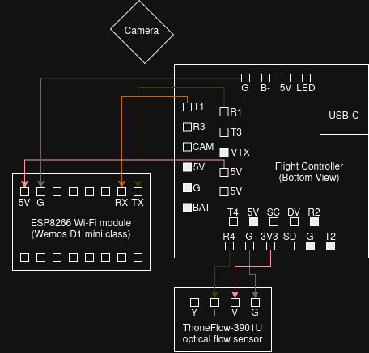

# Hardware overview

The hardware given to us is very straightforward: a Pilotix Brook 2.5" fully equipped and ready to fly. Some supporting tools were also given to us: a RadioMaster Pocket controller and some modules, namely a PMW3901 sensor and an ESP12-E Wi-Fi module.

## The drone

The Pilotix Brook 2.5" is actually the name of the kit, the frame and the propeller guards; everything else is customizable, so we had to discover what our drone came equipped with.

After a lot of research, this is the list of parts and what they do.

### OddityRC F7 40A AIO

This is the flight controller. Every drone needs one: it's like the motherboard of a computer, and everything is soldered onto it. It has a total of 5 UARTs; 2 of them came already in use, one for the video system and the other for the radio receiver.

This board came flashed with Betaflight, a great program for FPV but not so much for an autonomous drone, so we flashed it with another compatible firmware, INAV, which can communicate over the UART interfaces and can also fly autonomously. Why INAV: [INAV firmware choices](../telemetry/inav/README.md).

### [Video transmission system](../../docs/Video_Transmission.md)

#### Caddx Ratel 2

A small analog camera with surprisingly good video quality, perfect for FPV. In our case it will be a big source of information, used to guide the drone and tell it where it can go ([video into ROS](../../docs/FPV_Video_Receiver_Setup_UVC_Receiver_to_ROS.md)).

#### Ratel 2.0 Cherry Angle MMCX RHCP Antenna

A video transmission antenna that, in normal FPV use, exists so the pilot can see through the camera using a pair of FPV goggles.

#### PandaRC VT5804 Bat Lite 1300mW 5.8GHz VTX

A powerful video transmitter with more than enough range for our use case. We run it at its lowest power.

### [ELRS receiver](../../docs/ELRS_Guide.md)

The receiver that came soldered to our drone was quite the mystery: most listings for this drone say "ELRS 2.4GHz", but we couldn't find a brand or model on it. A CRSF ping script (now `project/telemetry/receiver_crsf_ping.py`) showed it was a TBS Crossfire XF Nano RX V3 running Crossfire firmware, so we replaced it with a BETAFPV Nano RX running ExpressLRS 4.1.0, bound to the RadioMaster Pocket.

---

> [!NOTE]
> Motors and propellers aren't that important in this project, since no great additional load was added to the drone, so we didn't test how much weight the drone could carry.

---
## Additional hardware

### PMW3901 sensor

An optical flow sensor that improves the drone's stability without GPS.

It communicates with the board through a UART interface (UART4), and unlike other 3901 sensors it has no distance sensor on board.

This sensor has a very small notch on the "camera"; that notch points to the back of the drone.

Our model is specifically the Thone ThoneFlow-3901U, which is basically the same sensor as the Holybro PMW3901, but it doesn't come pre-soldered or inside a 3D-printed case.

### MicoAir MTF-02P (planned)

Optical flow and a rangefinder (about 6 m) on one board. The team chose it to remove the PMW3901's biggest limitation, the missing distance sensor. It is not fitted yet (Nov 16), but the simulator already models it ([simulated sensors](../../docs/SIM_Sensors.md)).

### [ESP12-E Wi-Fi](../telemetry/README.md)

A compact, low-power device made for IoT applications. It comes with an ESP8266 and an onboard antenna.

It connects to the flight controller through UART1 and passes MSP between INAV and a ground computer over Wi-Fi.

We first flashed ours with MicroPython, then switched to esp-link for much lower latency ([Wi-Fi latency tests](../../docs/Telemetry_test.md)).

---

## Mounts

The drone has no mounts for the ESP and the PMW, so we modelled some in Blender. The STL files and slicer profiles are in [`3d-print/`](3d-print/).

> [!NOTE]
> None of the members had previous experience with 3D modelling and 3D printing, so there was a lot of trial and error.

The SEA:ME 3D printer is a [Wanhao Duplicator 12/230](../../docs/Wanhao_Duplicator_12-230.md), which has a ready-to-go Cura profile, but the team opted for PrusaSlicer since there was no easy way to install the Wanhao version on Linux, so tinkering with the profile was necessary for each print.

The mount for the PMW module goes on the underside of the drone and is screwed in with the screws already installed on the drone's bottom plate.

The mount for the ESP12 was tricky, since the module is much bigger than the PMW; it replaces the GoPro mount the drone came with.

## Hardware limitations

The drone and modules offered to us are very capable, but they all have clear limitations that we had to deal with during the project.

### PMW3901

The ThoneFlow-3901U is the most barebones a 3901 module can get: it has no external distance sensor and no bells and whistles, and of the two models that expose the module through a UART interface, it's the one without pre-soldered wires.

None of this would be a problem for people who already know how to solder and are used to such small parts, which none of us were.

The biggest hurdle is not having a distance sensor, which would be a big help. The MTF-02P is the planned answer.

### Pilotix Brook 2.5"

The drone offered to us is an amazing FPV drone, kitted out with high-RPM motors, a carbon fibre frame, a TBS Crossfire receiver and a modified version of the OddityRC F7 flashed with Betaflight.

The TBS Crossfire receiver had to be removed and replaced with an ExpressLRS one, because a proprietary radio link was a no-go for our project.

Betaflight is the industry standard for FPV firmware, but it has no autonomous flight capabilities and its communication over the UART interfaces isn't ideal, so we changed it for INAV.

Battery life is also a constraint that comes with the drone's specifications: the high-KV motors are great for fast, nimble drones, but at full throttle they use much more battery than lower-KV motors, and we don't plan to fly at high speeds, so the higher KV is wasted. Battery readings and limits: [Li-Po battery tests](../../docs/Li-Po_Battery_Tests.md).

## Wiring

We wired the ESP12, the ThoneFlow sensor and the ELRS receiver ourselves, during [Sprint 0](../../sprints/sprint_0.md).

| UART | Device | Voltage |
| --- | --- | --- |
| UART1 | ESP8266 (MSP) | 5 V |
| UART3 | VTX (IRC Tramp) | — |
| UART4 | ThoneFlow | 3.3 V |
| UART6 | free for add-ons | — |

## Files in this folder

| Folder | What's in it |
| --- | --- |
| [`3d-print/`](3d-print/) | Mounts (`esp12.stl`, `pmw3901.stl`, `holder.stl`, `box.stl`) and the PrusaSlicer profiles for the Wanhao |
| [`flight-controller/`](flight-controller/) | INAV `diff all` of 26 Oct 2026, the original Betaflight 4.5.1 backup, the accelerometer calibration, and the custom `ODDITYRCF7AIO` target build |
| [`esc/`](esc/) | Bluejay ESC settings and the configurator log |
| [`radio/`](radio/) | The ELRS 4.1.0 build flashed on the BETAFPV receiver |
| [`wiring/`](wiring/) | The wiring diagram |

## Ground station

The ground station is not a fixed computer but whichever machine is, at any point in time, ready to run everything we need for the drone to fly. [The ground station page](../../docs/Groundstation.md) explains it in more depth and shows how to connect to and use our Raspberry Pi.

[Sources](../../docs/Sources.md)

# Tags

#hardware
