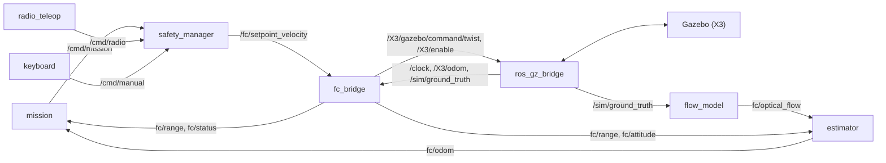

# ROS 2 stack: nodes, topics and parameters

Oct 20, 2026 · updated Nov 19, 2026

Everything that runs in `project/ros2/src/`, in the simulation and on the real drone. To start it, see [Using the Makefile](../../README.md#using-the-makefile). The simulated sensors are described in [SIM_Sensors](../../docs/SIM_Sensors.md), the test plan in [CI_Tests](../../docs/CI_Tests.md), and the test results in [Logs](../logs/README.md).

## System overview

This is what runs today, as started by `ros2 launch drone_bringup sim.launch.py` (which `make sim-keyboard` and `make sim-joy` call for you). The `source` argument chooses what commands the drone besides the radio (default `mission`: the action servers, idle until a goal arrives); `demo:=true` adds a scripted flight. The RadioMaster Pocket is **always** there as the override, like on the real drone: engaged, it takes over from any source. Acronyms are spelled out the first time they appear.



Setpoints travel one way: the sources (`mission`, `radio_teleop`, the keyboard) → `safety_manager`, which picks one → `fc_bridge` → `ros_gz_bridge` → Gazebo. Simulation time travels back through the same bridge on `/clock`, and every ROS (Robot Operating System) node runs on it because the launch sets `use_sim_time: true`. Since Oct 30 the sources no longer publish to `fc_bridge` directly: see `safety_manager`.

| Process | Language | Package | Started by |
| --- | --- | --- | --- |
| Gazebo (`gz sim`) | C++ (not a ROS node) | `ros_gz_sim` (apt) | `sim.launch.py`: the server, plus the window unless `headless:=true` |
| `parameter_bridge` | C++ | `ros_gz_bridge` (apt) | `sim.launch.py` |
| `fc_bridge` | C++ | `drone_fc_bridge` (ours) | `sim.launch.py`, always |
| `watchdog` | C++ | `drone_fc_bridge` (ours) | `sim.launch.py`, always |
| `safety_manager` | Python | `drone_safety` (ours) | `sim.launch.py`, always |
| `metrics_exporter` | Python | `drone_monitoring` (ours) | `sim.launch.py`, always |
| `flow_model`, `estimator` | Python | `drone_sim` (ours) | `sim.launch.py`, sim only |
| `mission` | Python | `drone_mission` (ours) | `sim.launch.py` (`source:=mission` is the default) |
| `demo_flight` | Python | `drone_mission` (ours) | `sim.launch.py demo:=true` (with `source:=mission`) |
| `joy_node` | C++ | `joy` (apt) | `sim.launch.py`, sim with `radio:=true` (the default) |
| `radio_teleop` | Python | `drone_teleop` (ours) | `sim.launch.py`, sim with `radio:=true` (the default) |
| `teleop_twist_keyboard` | Python | `teleop_twist_keyboard` (apt) | `make sim-keyboard`, on `/cmd/manual` |
| `flow_check`, `odom_check` | Python | `drone_sim` (ours) | By hand: `ros2 run drone_sim flow_check` / `odom_check` |

All our nodes read their parameters from `drone_bringup/config/sim.yaml`; the values in the tables below are the ones in that file, or the code default where the file doesn't set them.

## mission

Flies on request: three action servers, `mission/takeoff`, `mission/goto` and `mission/land`, with height from the rangefinder (`fc/range`), like INAV's SURFACE mode. One goal at a time; between goals in the air it holds height. Package `drone_mission`: the flight logic is plain Python in `drone_mission/logic.py` (no ROS, so it can be tested on its own); `drone_mission/mission.py` is the ROS node around it; `drone_mission/demo_flight.py` is a scripted client. The action types are in `drone_interfaces`.

**States:** `grounded → takeoff → hold ⇄ goto → land → grounded`, plus `range_lost`. On the ground it publishes nothing; in the air it publishes at `rate_hz` in every state, so `fc_bridge` never times out between goals.

| Action | Goal | Accepted when | Ends |
| --- | --- | --- | --- |
| `Takeoff` | `height` (0 = `target_h`) | On the ground, with rangefinder readings arriving for `ready_s` without a gap, below the rangefinder's `max_range`, and **armed**: by the radio (`radio_arms`, like the real drone), or, with `radio_arms` false, it arms first (`fc/arm`) | Within `tolerance` of the height: hold. Not there after `takeoff_timeout_s`: aborted, and it lands |
| `Goto` | `forward`, `left` (m), `yaw` (rad), `speed` (0 = `speed`) | Holding, with no other goal, with `fc/odom` | Within `pos_tolerance` and `yaw_tolerance`: hold. Aborted when odometry stops or after twice the ideal time plus `goto_margin_s` |
| `Land` | none | Whenever it's in the air. Aborts any other goal | Touchdown: grounded. Disarms only with `radio_arms` false; otherwise the pilot disarms with the radio |

`Takeoff` and `Goto` can be cancelled (it holds where it is); `Land` can't. A rejected goal logs why: `takeoff rejected: rangefinder not steady yet`, `takeoff rejected: not armed: arm with the radio`.

**Disarmed in the air** (`fc/status` goes from armed to disarmed: the radio's arm switch is the kill switch): the goal is aborted (`disarmed`) and it goes straight to **grounded**, silent. Only a change counts, so a status sent just before its own arm request landed can't abort a Takeoff.

**Goto is relative:** `forward` and `left` are in the heading the drone has when the goal starts, measured with `fc/odom`. Optical flow position drifts, so this is good for a few metres, not for coming back to an absolute spot. It flies towards the target at up to `speed` (slower within 1/`kp_xy` m of it), turns at up to `yaw_rate`, and holds height.

**Height:** `fc/range` × the world z of the body z axis (from `fc/odom`'s orientation), so tilt doesn't inflate it. `-inf` (below the sensor's minimum) counts as 0, the ground. In every airborne state, `vz = kp_z × (target − height)`, limited to ±`max_vz`; this corrects the X3 controller's sag.

**Touchdown,** either of: height below `ground_h` for `touchdown_s`; or, after 1.5 s in **land**, commanding down but not moving down (`fc/odom` z velocity above −0.03 m/s) for `touchdown_s`. The second works with no rangefinder at all.

**Range lost** (no message for `range_timeout_s`, or `+inf`) while flying: the goal is aborted (`rangefinder lost`) and it hovers in **range_lost**. If the range comes back within `lost_hold_s` it never climbs on its own: on the ground it goes back to **grounded**; after an interrupted Takeoff it holds the height it reached; otherwise it holds as before. If the range doesn't come back, it lands blind (touchdown from odometry). A `Land` goal sent then attaches to that landing.

**One thread:** the node runs a single-threaded executor. A running goal's `execute()` is a coroutine that waits for the next tick instead of sleeping, so it never holds up the 20 Hz commands. With the multi-threaded executor it used before, they stalled for up to 0.8 s at a time (fixed Nov 12; see D1 in [CI_Tests](../../docs/CI_Tests.md)). Every callback shares that one thread, so never block in one (`time.sleep`, `future.result()`): use `await` or `call_async`. Never hold `self.lock` across an `await`.

**Ctrl-C:** it keeps rclpy's signal handling, which wakes it even with no `/clock` and no messages. It exits in about 0.2 s, idle or during a goal, with or without sim time (checked Nov 12). The old executor sometimes printed a `The following exception was never retrieved: ...` line on the way out; this one didn't in that check.

| Item | Value |
| --- | --- |
| Subscribes | `fc/range` (`sensor_msgs/Range`), `fc/odom` (`nav_msgs/Odometry`), `fc/status` (`drone_interfaces/FcStatus`, for armed) |
| Publishes | `setpoint_velocity` (`geometry_msgs/TwistStamped`, frame `base_link`) at `rate_hz` (20), remapped to `/cmd/mission` |
| Subscribes (control) | `safety/active_source` (`std_msgs/String`): not `mission` or `none` means overridden |
| Actions | `mission/takeoff`, `mission/goto`, `mission/land` (`drone_interfaces/action/...`) |
| Calls | `fc/arm` (`std_srvs/SetBool`), only with `radio_arms` false: true on Takeoff, false after a Land |
| `target_h`, `tolerance` | 1.2 m, 0.05 m |
| `kp_z`, `max_vz` | 1.0 (m/s)/m, 0.3 m/s |
| `land_speed`, `ground_h`, `touchdown_s` | 0.15 m/s, 0.12 m, 1.0 s |
| `speed`, `kp_xy`, `pos_tolerance` | 0.3 m/s, 1.0 (m/s)/m, 0.10 m |
| `yaw_rate`, `kp_yaw`, `yaw_tolerance` | 0.5 rad/s, 1.5 (rad/s)/rad, 0.05 rad |
| `goto_margin_s` | 10.0 s |
| `range_timeout_s`, `ready_s`, `odom_timeout_s`, `lost_hold_s` | 0.5 s, 1.0 s, 0.5 s, 2.0 s |
| `takeoff_timeout_s` | 20.0 s |
| `radio_arms` | true; the launch sets false with `radio:=false` |

All parameters are read once at start.

**`demo_flight`:** a client that takes off to `height` (1.2 m), flies a square of side `side` (1.0 m: forward, quarter turn left, four times), and lands. It keeps asking for Takeoff for 2 minutes, since the mission refuses it until the rangefinder is steady and the drone is armed (arm with the radio); after any failed step, including Takeoff, it skips to Land.

**Sim result (Oct 29, 2026, headless, `source:=mission`, the demo):** every goal succeeded. Height stayed 1.19–1.22 m through all eight Goto goals. In Gazebo's true pose the square's sides were 0.82–0.91 m (the Goto ends within 0.10 m, and `fc/odom` drifts), and it came back 0.09 m from where it started. Landed, then `fc_bridge` logged `Disarmed (fc/arm)`. About 45 s of sim time. The nightly flight test (`make sim-test`) checks the same flight every night.

**Version 1 (Oct 29, `c50f8e9`)** ran a fixed flight (takeoff, hold, circle, yaw, land) with no actions; it settled at 1.20 m and held 1.197–1.203 m through the circle and a full turn.

## safety\_manager

Decides which command source reaches the drone. Since Oct 30 it is the **only publisher of `/fc/setpoint_velocity`**: every source publishes on its own topic, and `safety_manager` forwards one of them. Grew out of the watchdog, which only logs a timeout and still runs next to it. Package `drone_safety`: the rule is plain Python in `drone_safety/arbiter.py` (no ROS, tested on its own), `drone_safety/safety_manager.py` is the node.

| Source | Topic | Priority |
| --- | --- | --- |
| `radio_teleop` (RadioMaster Pocket) | `/cmd/radio` | 1, highest |
| Anything by hand: keyboard (`make sim-keyboard`), `ros2 topic pub` | `/cmd/manual` | 2 |
| `mission` | `/cmd/mission` | 3 |

**The rule:** the highest-priority source that has published within `source_timeout_s` is active, and only its commands are forwarded, as they arrive (no added delay). With none active nothing is forwarded, so `fc_bridge`'s timeout sends zero, as before.

**Taking over:** `radio_teleop` only publishes while its arm and takeover switches are both on, so **flipping takeover on (with arm on) takes control** from the mission, and either switch off gives it back. Taking over also arms `fc_bridge`, so it works after a Land. The active source is published on `safety/active_source` (`std_msgs/String`, latched) and logged on every change: `Active source: radio`, `No source publishing: fc_bridge times out and sends zero`.

**`mission` listens to it:** when another source becomes active it aborts its goal (`overridden by radio`) and goes quiet in state **overridden**, refusing new goals. When control comes back (active is `mission` or `none`) it never resumes on its own: on the ground it goes to **grounded**, in the air it holds the height it is at. If the drone was disarmed meanwhile (the kill switch under the radio), it goes to **grounded** whatever the height: holding a falling drone would make it climb once re-armed. Then it takes new goals.

**Low battery:** a placeholder. It subscribes to `fc/battery` (`sensor_msgs/BatteryState`; published by `fc_bridge` with `backend:=inav`, nothing publishes it in the sim) and warns once below `battery_low`. Returning or landing comes later.

| Item | Value |
| --- | --- |
| Subscribes | `cmd/radio`, `cmd/manual`, `cmd/mission` (`geometry_msgs/TwistStamped`, sensor-data QoS); `fc/battery` |
| Publishes | `fc/setpoint_velocity` (`geometry_msgs/TwistStamped`); `safety/active_source` (`std_msgs/String`, transient local) |
| `priority` | `["radio", "manual", "mission"]`, highest first; each name `n` is the topic `cmd/n` |
| `source_timeout_s` | 0.3 s, equal to `fc_bridge`'s `setpoint_timeout_s` |
| `battery_low` | 0.2 (fraction) |

**Sim result (Oct 30, 2026, headless, with `ros2 topic pub` standing in for the radio):** during a 3 m Goto, commands on `/cmd/radio` took over at once; the Goto aborted with `overridden by radio`; the "radio" brought the drone from 1.20 m down to 0.28 m; when it stopped, `mission` held at about 0.33 m (no climb back) and accepted a Land.

## watchdog

An observer that reports when the setpoint stream into `fc_bridge` stops. Package `drone_fc_bridge`, file `src/watchdog.cpp`, next to `fc_bridge`.

1. On startup, sets "last message received" to now.
2. Every time a setpoint arrives, updates "last message received".
3. Every 100 ms, checks how long ago that was. When the gap first exceeds `timeout_s`, logs `No setpoint for X s: a real failsafe would command hover`. When messages come back, logs `Setpoints are back`. It only logs on these changes, never every tick.

It **commands nothing**. The drone's actual failsafe is `fc_bridge`'s 0.3 s timeout; the watchdog warns later, at 0.5 s, so a warning always means the zero has already gone out. A warning right after launch is expected: nothing publishes until a source is active.

| Item | Value |
| --- | --- |
| Subscribes | `setpoint_velocity` (`geometry_msgs/TwistStamped`), remapped to `/fc/setpoint_velocity`: what `fc_bridge` receives |
| QoS | Sensor-data profile (best effort, small queue); connects to reliable and best-effort publishers |
| `timeout_s` | 0.5 s (code default; `sim.yaml` has no `watchdog` section) |
| Check period | 100 ms, fixed in code |

## fc\_bridge

The only node allowed to command the drone. Parameter `backend`: `sim` (Gazebo) or `inav`, the real FC (flight controller) over MSP through the ESP8266. `inav` reads INAV over MSP through esp-link (`src/inav_link.*`, TCP port 23) and publishes the same state topics as the sim, plus `fc/optical_flow`, `fc/battery`, `fc/rc` and `fc/motors`. By default it is listen-only: it only sends read requests (an allow-list in `src/msp.cpp`) and setpoints go nowhere. With `rc_override` true it also sends the setpoints as stick positions (item 10). It always refuses `fc/arm` (only the radio arms the real drone). It has no Gazebo topics and no enable, so nothing sim-only can reach the real drone. Any other value stops the node at start. Package `drone_fc_bridge`, file `src/fc_bridge.cpp`.

**What it does**

1. **Receives** setpoints on `fc/setpoint_velocity` and stores the latest one with the time it arrived. The message's own header timestamp is not used. A setpoint with NaN (Not a Number) or infinity in any field is dropped with a warning (at most once a second) and not stored, so the previous one keeps ageing and the timeout takes over.
2. **Ticks** at `rate_hz` (20 Hz). Each tick it decides whether the stored setpoint is fresh: it arrived no more than `setpoint_timeout_s` ago, and not in the "future" (which happens when sim time is reset). With `inav` it also checks that INAV replied within `telemetry_timeout_s`: setpoints computed from older state are treated as stale (log: `No reply from INAV for over 0.30 s: holding (centred sticks)`, then `INAV is answering: setpoints can be followed`).
3. **Fresh:** clamps it and publishes it to Gazebo.
4. **Stale or none yet:** publishes zero velocity. Gazebo's controller keeps following the last command it received, so this explicit zero is what makes the drone stop and hover. That is the failsafe.
5. **Logs** only on changes: `Setpoints received, following them` and `Setpoint timeout: holding (zero velocity)`. It starts stale, so it publishes zeros and logs nothing until the first setpoint.
6. **Keeps the sim drone enabled** (sim only) by publishing the armed state on the enable topic once a second and on every change. Disarmed, the X3's motors stop. `armed_at_start` is set by the launch: false with the radio (it arms), true with `radio:=false`. With `inav`, `armed` is what INAV reports, and `link_ok` and `state_age_s` in `fc/status` say whether the FC is answering. On the real drone (Nov 16): attitude, odometry and flow at 10 Hz, attitude signs as in ROS, and the link back by itself after a power cut ([bench notes](../logs/measurements/inav_link/2026-11-16_dbf5804/notes.md)).
7. **Reports state** for every Gazebo odometry message on `/X3/odom` (50 Hz), shaped like what INAV reports, not like the perfect pose Gazebo knows:
   - `fc/attitude`: the orientation alone.
   - `fc/range`: a downward rangefinder, set up in `sim.yaml` as the MicoAir MTF-02P. Reads distance along the body's down axis, so longer when tilted; `+inf` above `range_max`, `-inf` below `range_min` (REP 117). About 0.05 m with the drone on the ground.
   - `fc/odom`, only with `publish_odom` true (the code default): velocity in the body frame with noise and a slowly wandering bias, like optical flow, and horizontal position integrated from it, so it drifts (about 0.5 m per minute with the defaults). `sim.yaml` sets `publish_odom: false`, because the `estimator` (`drone_sim`) now builds `fc/odom` from the simulated flow, range and attitude, as INAV would. See [SIM_Sensors](../../docs/SIM_Sensors.md).
8. **Services** (`std_srvs/SetBool`): `fc/arm` sets the armed state (sim only: `radio_teleop` calls it from the arm switch, or `mission` with `radio:=false`; `inav` refuses it); `fc/hold` true makes it ignore setpoints and send zero until set false. Both log the change.
9. **Status** on `fc/status` (`drone_interfaces/FcStatus`) once a second and on every change: backend, armed, holding, following setpoints, setpoint age, rangefinder valid; with `inav` also `link_ok`, `state_age_s`, `rc_override_active` (INAV reports its MSP RC OVERRIDE mode on) and `rc_sent` (sticks are being sent).
10. **Sticks to INAV** (`inav` with `rc_override` true only). Each tick the clamped setpoint becomes four stick values (`src/inav_sticks.*`): `1500 + 500 × v / limit` µs per axis, so `max_speed_xy`, `max_speed_z` and `max_yaw_rate` are full stick. Forward is pitch up, left is roll left (below 1500), up is throttle up, turning left is yaw left (below 1500). Stale setpoints or `fc/hold` send centred sticks. The link sends them first in every poll cycle as `MSP_SET_RAW_RC`, the only write it can build: four channels, never an AUX channel, so never arming. Sticks the node hasn't refreshed in 0.3 s, or a dropped link, stop the frames.
    - INAV uses them only while its **MSP RC OVERRIDE** mode is on (on our radio: switch SA, channel 7) and only on the channels in `msp_override_channels` (15: all four); otherwise the radio flies. On the bench it took them over 1–2 s after the frames started, and was back on the radio within about 2 s after they stopped. `fc/rc` (`drone_interfaces/RcChannels`) shows what INAV actually uses.
    - What a stick means is up to INAV's mode, **not** the sim's velocity: in ANGLE, roll and pitch are a bank angle and throttle is raw power, so centred throttle (1500) is about half power, not hover. Bench-tested, unarmed (`make bench-rc`, [notes](../logs/measurements/inav_rc_override/2026-11-17_70e3202/notes.md), [script](../scripts/bench_rc_override.sh)). With the radio off and SA on, the override keeps applying while disarmed; armed, INAV's failsafe still disarms. Armed, props off, ROS's sticks drive the motors as the mixer should (`make bench-armed`, [notes](../logs/measurements/inav_rc_override/2026-11-17_c3c73c0/notes.md), [script](../scripts/bench_rc_armed.sh)); `fc/motors` shows them.

**The clamp**, applied to every command before it leaves:

- Horizontal: if the speed `hypot(x, y)` is above `max_speed_xy`, both components are scaled down together, so direction is kept and only the speed is capped.
- Vertical: `z` is limited to ±`max_speed_z`.
- Yaw: `angular.z` is limited to ±`max_yaw_rate`.
- Roll and pitch rates (`angular.x`, `angular.y`) are always sent as zero.

| Item | Value |
| --- | --- |
| Subscribes | `fc/setpoint_velocity` (`geometry_msgs/TwistStamped`), sensor-data QoS |
| Subscribes | `sim_odom_topic` (`nav_msgs/Odometry`), sensor-data QoS |
| Publishes | `gz_twist_topic` (`geometry_msgs/Twist`) every tick; `gz_enable_topic` (`std_msgs/Bool`) every 1 s; `fc/attitude` (`geometry_msgs/QuaternionStamped`), `fc/range` (`sensor_msgs/Range`) and, with `publish_odom`, `fc/odom` (`nav_msgs/Odometry`) per sim odometry message; `fc/status` (`drone_interfaces/FcStatus`). With `inav`: no Gazebo topics; `fc/odom`, `fc/attitude`, `fc/range`, `fc/optical_flow` (`drone_interfaces/OpticalFlow`), `fc/battery` (`sensor_msgs/BatteryState`), `fc/rc` (`drone_interfaces/RcChannels`) and `fc/motors` (`drone_interfaces/MotorOutputs`, what INAV sends each motor) whenever INAV answers |
| Services | `fc/arm`, `fc/hold` (`std_srvs/SetBool`) |
| `backend` | `sim` or `inav` (read once at start) |
| `gz_twist_topic` | `/X3/gazebo/command/twist` |
| `gz_enable_topic` | `/X3/enable` |
| `rate_hz` | 20.0 (read once at start) |
| `setpoint_timeout_s` | 0.3 s |
| `max_speed_xy` | 0.5 m/s |
| `max_speed_z` | 0.3 m/s |
| `max_yaw_rate` | 1.0 rad/s |
| `sim_odom_topic` | `/X3/odom` (read once at start) |
| `publish_odom` | false in `sim.yaml` (code default true): the estimator publishes `fc/odom` |
| `flow_vel_noise` | 0.02 m/s, white noise on velocity (code default; only used with `publish_odom` true) |
| `flow_drift` | 0.002 m/s per √s, random walk of the velocity bias (code default; only with `publish_odom` true) |
| `range_min`, `range_max` | 0.02 m, 6.0 m (MTF-02P; code defaults 0.04 m and 4.0 m, VL53L1X-like) |
| `range_noise` | 0.01 m, a placeholder until bench data (code default 0.005 m) |
| `range_fov` | 0.070 rad, a 4° full cone (code default 0.47 rad) |
| `armed_at_start` | true (read once at start; sim only; the launch sets it) |
| `msp_host`, `msp_port` | `192.168.4.1`, 23 (inav only; esp-link's transparent port. Never 2323: it resets the FC) |
| `msp_timeout_s` | 0.25 s for a poll cycle's replies (inav only) |
| `telemetry_timeout_s` | 0.3 s (inav only): no reply from INAV for longer holds, like a stale setpoint |
| `rc_override` | false (read once at start; inav only): true sends setpoints to INAV as sticks |

Timeout and clamp limits are read every tick, so `ros2 param set` changes them live. Numeric parameters are doubles, except `msp_port`: set them as `2.0`, not `2`. The code still declares every parameter with a default; `sim.yaml` only overrides the value. Removing a declaration makes the node crash the first time it reads that parameter.

The clamp limits are safety caps meant for the real airframe. Tune stick feel in `radio_teleop` (`max_xy`, `max_z`, `max_yaw`), not here.

## radio\_teleop

Turns the RadioMaster Pocket, connected over USB as a joystick, into velocity setpoints. **Sim only**: on the real drone the radio talks ELRS (ExpressLRS) straight to INAV and never goes through ROS. Package `drone_teleop`, file `drone_teleop/radio_teleop.py`. Use the Pocket's `INAV-SIM` model copy, with Internal RF off.

**What it does, for every `/joy` message** (`joy_node` repeats the last state at 20 Hz):

1. **Arm switch (SA) arms and disarms** the drone through `fc/arm`, like INAV on the real drone. It arms once SA has read on for `arm_hold_s` without a break (the Pocket's switch bounces), and only with the throttle centred (`Centre the throttle stick to arm`). Like INAV, it won't arm on a switch that was already on when it started: flip it off and on (`Arm switch was on at start`). **SA off disarms at once, even in flight: it's the kill switch**, and the sim drone drops.
2. **Takeover switch** (`axis_takeover`, axis 6 on the Pocket; −1 means none, arm alone takes over): while armed and on for `arm_hold_s`, and with the throttle centred, the sticks take control (`Engaged`). Takeover off, or SA off, releases at once (`Released`): nothing is published, so the mission keeps control, or with none `fc_bridge` times out and holds. Armed with takeover off, the radio is ready but the mission flies.
3. On the real drone the radio arms INAV itself (ARM on SD, PREARM on SE), and SA is INAV's MSP RC OVERRIDE switch between the companion (MSP) and the sticks; neither node runs there.
4. Once engaged: applies sign and deadband to each stick and publishes `TwistStamped` (frame `base_link`). Right stick: forward/back and strafe. Left stick: up/down and yaw.

| Item | Value |
| --- | --- |
| Subscribes | `joy` (`sensor_msgs/Joy`) |
| Calls | `fc/arm` (`std_srvs/SetBool`): true when SA arms, false when it goes off |
| Publishes | `setpoint_velocity` (`geometry_msgs/TwistStamped`), remapped to `/cmd/radio`: only while engaged, which is what makes the radio take over |
| Axes | roll 0, pitch 1, throttle 2, yaw 3, arm 4, takeover 6 |
| Signs | roll 1.0, pitch −1.0, throttle −1.0, yaw 1.0, arm −1.0, takeover −1.0 (`joy_node` inverts every Pocket axis) |
| `arm_hold_s` | 0.1 s; off still acts at once |
| `deadband` | 0.08 |
| `max_xy`, `max_z`, `max_yaw` | 0.5 m/s, 0.3 m/s, 1.0 rad/s at full stick |

`joy_node` opens the radio by name (`device_name: "OpenTX Radiomaster Pocket Joystick"`), so a laptop accelerometer or another gamepad can't be picked by mistake.

## metrics\_exporter

Turns the stack's topics into Prometheus metrics for the Grafana "Drone health" dashboard (`make monitor`, http://localhost:3000). It only listens: if it fails, the rest flies on. Package `drone_monitoring`: the bookkeeping is plain Python in `drone_monitoring/metrics.py` (tested on its own), `drone_monitoring/metrics_exporter.py` is the node.

| Item | Value |
| --- | --- |
| Subscribes | `fc/status`, `fc/range`, `fc/odom`, `fc/attitude`, `fc/optical_flow`, `fc/battery`, `fc/setpoint_velocity`, `safety/active_source` |
| Serves | `address`:`port`, 127.0.0.1:9105, scraped by `monitoring/prometheus.yml` |
| `stale_after_s` | 3.0 s: a topic quiet this long shows NO DATA in Grafana, but keeps its message counter |

## ros\_gz\_bridge and Gazebo

**`parameter_bridge`** (package `ros_gz_bridge`, installed with apt) is a translator. Gazebo has its own message system (`gz topic`), separate from ROS, and the bridge copies messages between the two for exactly the topics it is told about:

| Topic | Direction | ROS type | Gazebo type |
| --- | --- | --- | --- |
| `/X3/gazebo/command/twist` | ROS → Gazebo | `geometry_msgs/Twist` | `gz.msgs.Twist` |
| `/X3/enable` | ROS → Gazebo | `std_msgs/Bool` | `gz.msgs.Boolean` |
| `/clock` | Gazebo → ROS | `rosgraph_msgs/Clock` | `gz.msgs.Clock` |
| `/model/x3/odometry` → `/X3/odom` | Gazebo → ROS | `nav_msgs/Odometry` | `gz.msgs.Odometry` |
| `/model/x3/odometry` → `/sim/ground_truth` | Gazebo → ROS | `nav_msgs/Odometry` | `gz.msgs.Odometry` |

The list lives in `drone_bringup/config/gz_bridge.yaml`, which the bridge reads through its `config_file` parameter. In YAML the ROS and Gazebo names can differ. Odometry lands twice: on the internal `/X3/odom`, which `fc_bridge` turns into `fc/attitude` and `fc/range`, and on `/sim/ground_truth`, which `flow_model` and the tests read. Note the **lowercase** `x3` in the Gazebo odometry topic, unlike the command topics.

`/X3/odom` arrives at 50 Hz with `frame_id: x3/odom` and `child_frame_id: x3/base_footprint`; covariances are all zero; the twist is in the body frame. Nothing above `fc_bridge` should read it, nor `/sim/ground_truth`: they are ground truth the real drone won't have. Any topic not listed does not cross. The X3 model has no IMU (inertial measurement unit) sensor, so there is none to bridge.

**Gazebo** (`gz sim`, Gazebo Harmonic) is not a ROS node. By default it loads our `room_world.sdf` (SDF: Simulation Description Format), the lab room, running from the start (`-r`); `outdoor_field.sdf` is there too (`drone_bringup/worlds/`), and Gazebo's own `multicopter_velocity_control.sdf` opens with `world:=multicopter_velocity_control.sdf`. That one holds two quadcopters, X3 and X4; only X3 is used. X3 has a built-in velocity controller: given a Twist, it works out the motor speeds to reach that velocity and holds it until the next command. Underneath, the physics is real: per-rotor motor models (thrust, rotor drag, spin-up), gravity and collisions. The controller reads commands in the **body frame** (verified Oct 22, 2026: forward follows the nose to within 1°). It accepts commands only while enabled. Our stack never touches the X4 or the `motor_speed` topic, which drives the propellers directly.

**Camera views** (#237). `sim.launch.py camera:=...` picks the main view of the Gazebo window; `make sim-keyboard` and `make sim-joy` ask for it before starting:

| `camera` | Window shows | How |
| --- | --- | --- |
| `free` (default) | Gazebo's own view, moved with the mouse | Gazebo's default window |
| `follow` | Behind and above the drone, turning with it | `config/gui/follow.config` (offset `-1.5 0 0.6`); the launch asks the window to follow `x3` once it is up, because the config alone starts before the drone is in the scene |
| `fpv` | The drone's front camera, filling the window | `config/gui/fpv.config`: an image panel on Gazebo topic `/fpv/image` |

The FPV camera is a sensor on the X3 in our worlds only (`room_world.sdf`, `outdoor_field.sdf`): 120° wide, 640×480 at up to 30 Hz, on the front edge of the body and tilted 20° up like a real FPV camera. The X3 comes from Fuel, so each world adds it in its `<include>` with `<experimental:params>`; a new world needs the same block. In Gazebo's default world `fpv` shows nothing. The camera image stays in Gazebo; it is not bridged to ROS. Gazebo always runs as two processes, the server (`gz sim -s -r <world>`) and the window (`gz sim -g`, which ends the launch when closed): in one process, the window and the camera's rendering deadlock on the dev container's software rendering, and Gazebo shows nothing. With no GPU (the dev container), the camera reaches about 10 frames per second.

## Launch files

`drone_bringup/launch/sim.launch.py` is installed by the `install(DIRECTORY launch config ...)` line in that package's `CMakeLists.txt`. A new launch file only becomes visible to `ros2 launch` after `colcon build` (`make ws`).

**`sim.launch.py`: the simulation (or the real drone) with a choice of commander**

| Argument | Values | Default |
| --- | --- | --- |
| `backend` | `sim`: Gazebo. `inav`: the real drone over MSP (reads state only; setpoints go nowhere unless `fc_bridge`'s `rc_override` is true, which the launch doesn't set). No Gazebo, bridge, sim sensors, radio nodes or sim time with `inav` | `sim` |
| `source` | `mission` (action servers), `none` (anything else is rejected) | `mission` |
| `radio` | `true`, `false`. Sim only. `false`: no Pocket (someone else has it): no radio nodes, `fc_bridge` starts armed and `mission` arms on Takeoff and disarms after Land | `true` |
| `demo` | `true`, `false`: with `source:=mission`, fly the scripted square (`demo_flight`). Without it nothing flies until a goal is sent or the radio takes over | `false` |
| `world` | Sim only: SDF file name (ours in `worlds/` win) or full path | `room_world.sdf` |
| `camera` | `free`, `follow`, `fpv`. Sim only: the Gazebo window's main view (see Camera views) | `free` |
| `headless` | `true`, `false`. Sim only. `true`: Gazebo's server without its window, for CI and the nightly flight test | `false` |

Everything is decided in one function once the arguments are known (`OpaqueFunction`), so switching sim and real is one argument, never a node.

0. Before starting anything, the launch checks that every package it needs is found, and (sim only) that no other `gz sim` runs in your `GZ_PARTITION`; otherwise it stops with the reason. Two sims in one partition share topics, so `fc_bridge` would read both drones in turn and the drone flickers.
1. Always, at once: `fc_bridge`, `watchdog`, `safety_manager` and `metrics_exporter`. With `backend:=sim` also Gazebo (server, and the window unless `headless:=true`), `parameter_bridge` (with `config/gz_bridge.yaml`), `flow_model` and `estimator`. ROS launch gives no ordering between them; that is fine, because `fc_bridge` simply sits frozen until `/clock` arrives.
2. `source:=mission` (the default): `mission`, idle until a goal arrives; with `demo:=true` also `demo_flight`, at once (`demo_flight` retries Takeoff for 2 minutes, until the rangefinder is up and you've armed with the radio).
3. `source:=none`: nothing flies the drone on its own; fly it with the radio alone, or by hand (keyboard on `/cmd/manual`, which is what `make sim-keyboard` does).
4. With `backend:=sim` and `radio:=true` (the default): `joy_node` and `radio_teleop`. The real drone never flies without the radio as a backup, and only the radio arms it, so the sim does the same. With the Pocket unplugged, `joy_node` waits quietly and picks it up when it appears; until you arm, nothing flies.
5. All our nodes get `config/sim.yaml`, and `use_sim_time` true with `sim` (false with `inav`). Each source is remapped from `setpoint_velocity` to its own topic: `/cmd/mission` (`mission`) or `/cmd/radio` (`radio_teleop`). The watchdog is remapped to `/fc/setpoint_velocity`.
6. Ctrl-C stops everything together. Every Python node handles the shutdown race in rclpy (the context can close between two waits), so none of them dies with a traceback.

What the Makefile starts: `make sim-keyboard` is `source:=none radio:=false camera:=<your choice>` plus `teleop_twist_keyboard` on `/cmd/manual`; `make sim-joy` is `source:=none camera:=<your choice>`; `make sim-test` is `headless:=true radio:=false` inside the flight test.

## Known issues and limitations

None of these stop the simulation from working today. The priority says when each must be fixed: **before flight** means before ROS flies the real drone.

| Issue | Where | What can go wrong | Fix | Priority |
| --- | --- | --- | --- | --- |
| Centred throttle is half power on the real drone | `fc_bridge` `inav` backend, INAV config | In ANGLE with no ALTHOLD, throttle 1500 from ROS is raw half throttle, not a hover | ALTHOLD (or surface mode) on a switch before ROS flies it | Before flight |
| Yaw direction not confirmed | INAV mixer, `inav_sticks` | Yaw left (1250) raised motors 2 and 3 on the bench; which way that turns depends on the spin direction | Push the radio's yaw stick left with SA off, props off, and compare | Before flight |
| Wi-Fi latency has a long tail | `fc_bridge` `inav` backend | Round trips are bimodal (half under 40 ms, many 140–180 ms) and 1 in 20 takes over 0.75 s ([measured Nov 12](../../docs/Telemetry_test.md)); a setpoint reaches INAV 150–270 ms after it is published | The backend reconnects after 0.75 s of silence and INAV's failsafe covers the rest; keep the drone's ESP to one client | Before flight |
| No IMU in the sim | X3 model | No `fc/imu`; nothing needs it yet | Own world and model copy with an IMU sensor when `safety_manager` needs it | Later |
| Flow position drifts while landed | sim odometry | Sitting on the ground, `fc/odom` xy can still drift; INAV ignores flow when landed | Stop integrating near the ground if it gets in the way | Watch |
| Sensor model is a guess | `flow_model`, `fc_bridge` sim backend | Noise and drift in `sim.yaml` are placeholders, not measured on our hardware | Fit the MTF-02P, measure it on the bench, update `sim.yaml` | Before flight |
| Velocity-only control: height drifts | X3 controller | Holds zero vertical speed, not a height: drifts down about 1 cm every 6 s and loses about 15 cm in a yaw. Still true for the radio and the keyboard; `mission` corrects it | Altitude hold for the radio too, in `safety_manager` | Later |
| Takeoff overshoot | `mission` | Overshoots the target by about 4 cm before settling | Lower `kp_z` near the target, or slow the climb before it | Watch |
| `-inf` in the air is read as the ground | `mission` | A rangefinder failing as `-inf` in flight would look like height 0, so the mission climbs | Cross-check with `fc/odom` z before trusting `-inf` | Before flight |
| Goto ends short of the target | `mission` | Ends within `pos_tolerance` (0.10 m) of an `fc/odom` target, and `fc/odom` drifts: the sim's 1 m sides came out 0.82–0.91 m | Lower `pos_tolerance`; accept that flow can't do exact distances | Watch |
| Armed on the ground after landing | `mission` | With the radio arming (default), the mission never disarms: the pilot does, with SA. With `radio:=false`, only a successful Land goal disarms; landing after a lost rangefinder or a takeoff timeout stays armed | Like the real drone; disarm with the radio. INAV can also auto-disarm on landing | Later |
| One goal at a time, no queue | `mission` | A second Goto is rejected while one runs; clients must wait | A queue, or waypoint lists in one goal, when missions need it | Later |
| Mission command gaps under CPU load | `mission` | Twice in the sim its 20 Hz commands paused for more than 0.3 s while a `ros2` CLI started, so `fc_bridge` sent zero for a moment | Watch; if it shows up on the real laptop, raise `source_timeout_s`/`setpoint_timeout_s` a little or move the timer to its own thread | Watch |
| `mission` sometimes slow to exit | `mission` | Once in 11 Ctrl-Cs (Oct 30, after a radio takeover) it didn't exit within 15 s; not reproduced since | Watch; launch kills it after 15 s anyway | Watch |
| Radio-as-joystick needs RF off | Pocket | A transmitting radio could command a bench drone | Always use the `INAV-SIM` model copy with Internal RF off | Always |
| Frame names differ | `fc_bridge`, Gazebo | Commands say `base_link`, the sim says `x3/base_footprint`; harmless until tf is used | Align when tf is introduced | Later |
| One-off timeout right after the first setpoint | `fc_bridge` | Seen once at startup: `received`, then `timeout` 14 ms later, then fine | Watch for it; if it repeats while setpoints flow, sim time is jumping and the timeout needs a margin | Watch |
| Topics fixed to the X3, no namespace | all nodes | Fine for one drone; two drones would clash | Namespaces per drone when multi-agent work starts (Module 3) | Later |

**Resolved since Oct 20, 2026:** NaN passing through the clamp (now rejected in `fc_bridge`), no odometry in ROS (`/fc/odom`), and the unverified velocity frame (body frame confirmed). Since Oct 26: failsafes tested by hand only (now automated, see below), drone models lost when the container is recreated (now in the `gz-cache` volume), and the arm switch bounce (confirmed with `project/scripts/ros2_tools/arm_bounce.py`, debounced by `arm_hold_s` in `radio_teleop`). Since Oct 27: `/fc/odom` published by the bridge instead of `fc_bridge`, and no attitude topic. Since Oct 29: timed takeoff, never landing, and height drift in autonomous flight (the `mission` node); no disarm after landing in the sim (`mission` calls `fc/arm`). Since Oct 30: one commander at a time (`safety_manager` arbitrates; the radio overrides a running mission); sim-only enable and ROS arming reaching the real drone (`backend:=inav` has no enable topic and refuses `fc/arm`; in the sim only the radio arms, unless `radio:=false`). Since Nov 12: the mission's command stalls (single-threaded executor) and the Wi-Fi latency measured. Since Nov 16–17: the `inav` backend reads the real drone and sends sticks through MSP RC OVERRIDE; the radio failsafe still disarms with the override on. The rangefinder's ground reading sitting near `range_min` is gone with the MTF-02P's 0.02 m minimum, and `mission` treats `-inf` near the ground as landed.

## Tests

Every automated test, what still needs adding, and how CI runs them: [CI_Tests](../../docs/CI_Tests.md). This section is the detail for the ROS tests.

**To run every test and keep the results**, from the repo root on the host:

```bash
make test
```

A clean build and `colcon test` with the same commands as CI, plus the telemetry tests; each run gets a dated folder in `project/logs/tests/` with a report, every test's result, the full log, and a line in `project/logs/tests/history.csv`. See [Logs](../logs/README.md). The Gazebo flight test runs separately: `make sim-test`.

For a quick check while working, inside the container (`make shell`):

```bash
cd ~/ros2_ws && colcon build && colcon test --packages-select drone_fc_bridge drone_teleop drone_mission drone_safety && colcon test-result --verbose
```

| Test file | What it checks |
| --- | --- |
| `drone_fc_bridge/test/test_failsafes.py` | `launch_testing`: starts `fc_bridge` alone on the wall clock. Zero with no setpoints; fresh setpoints forwarded; zero within 0.3 s (± 0.15) of the last setpoint; NaN and infinity rejected and timed out; horizontal clamp keeps direction; z and yaw clamped; roll and pitch rates zeroed; sim enable published. Runs on its own domain (199, localhost only), so a running sim does not interfere. |
| `drone_fc_bridge/test/test_state.py` | `launch_testing`: `fc_bridge` with noise off, fed fake `/X3/odom`. Velocity passes through; xy position is integrated, not copied from the sim; body velocity is rotated by heading; height and attitude from the sim; range is z when level, 2z at 60° roll, `±inf` out of range or upside down. Uses the code defaults, not `sim.yaml`. |
| `drone_fc_bridge/test/test_services.py` | `launch_testing`: starts armed; `fc/arm` false/true changes the enable topic and `fc/status`; `fc/hold` sends zero despite fresh setpoints, and releasing it follows them again; `fc/status` reports the setpoint age. |
| `drone_fc_bridge/test/test_watchdog.py` | `launch_testing`: the watchdog as the launch starts it, on `/fc/setpoint_velocity`; it warns when the stream stops (0.5 s) and when it is back, read from `/rosout`. |
| `drone_fc_bridge/test/test_inav.py` | `launch_testing`: `fc_bridge` with `backend: inav`, its MSP link pointed at a closed port (and `armed_at_start` true, which must not apply). `fc/status` says `inav` and disarmed; `fc/arm` true and false both refused; nothing published on the Gazebo twist or enable topics, and no publisher on them. |
| `drone_fc_bridge/test/test_inav_state.py` | `launch_testing`: `fc_bridge` with `backend: inav` against a fake INAV on localhost that answers with hand-built replies. `fc/status` armed, `link_ok`, state age; `fc/attitude` in ROS convention (heading 90° east is yaw −90°); `fc/odom` position north-west-up and velocity rotated into the body frame (checked against an independently written rotation); `fc/range` 1.2 m; `fc/optical_flow` passes through in rad/s; `fc/battery` volts, current negative while discharging, percentage, cells; only read requests reach the FC; no `fc/range` without the rangefinder bit; silence turns `link_ok` false. |
| `drone_fc_bridge/test/test_inav_rc.py` | `launch_testing`: `fc_bridge` with `backend: inav` and `rc_override: true` against a fake INAV that acts like MSP RC OVERRIDE. No setpoint sends centred sticks; each axis in AETR order with ROS signs; clamped to the speed limits; setpoint timeout and `fc/hold` centre the sticks; `fc/rc` and `fc/status` follow the override switch; only reads and sticks reach the FC. |
| `drone_fc_bridge/test/test_msp.cpp` | gtest, no ROS: MSP v2 framing in `src/msp.*`. CRC; requests byte-identical to `inav_telemetry.py`; only the read commands on the allow-list can be built, and `MSP_SET_RAW_RC` is the only write: exactly four channels in AETR order, values outside the stick range refused; every good frame in the four captures (`test/data/`, copies of `project/telemetry/inav/msp/captures/`) parses, the damaged ones don't, and any chunking gives the same frames; a good reply hidden inside a damaged one is recovered; garbage, request frames, error frames, oversized sizes; `skip_pending()` releases the replies behind a damaged header; a 2 MB backlog drains in linear time. |
| `drone_fc_bridge/test/test_inav_decode.cpp` | gtest, no ROS: the INAV decoders in `src/inav_decode.*` against captured frames (attitude, status, battery, optical flow, rangefinder, local pose, versions); short payloads refused, longer ones accepted; signed fields; rangefinder 0 cm is no reading; status sensor mask `0xa3` and not armed in every capture; a made-up armed status reads armed. |
| `drone_fc_bridge/test/test_inav_link.cpp` | gtest, no ROS: the TCP link in `src/inav_link.*` against a fake FC on localhost that answers with captured frames. Polls and decodes status, pose, flow, range and battery (battery every 5th cycle) after checking the FC is INAV; asks for the mode list until it has one; sends a cycle's requests at once; sends the sticks every cycle while they are fresh and stops when they go stale, on `nullopt` or while the link is down; reads the override mode from the status bit; lost replies and rubbish are not a dead link; a link that goes silent, or a bridge that hangs up, leads to a reconnect; a non-INAV FC is never polled; `stop()` is prompt while connects are refused. |
| `drone_fc_bridge/test/test_inav_sticks.cpp` | gtest, no ROS: setpoint to sticks in `src/inav_sticks.*`. Zero is centred; each sign; full scale is full stick and comes from the config; faster is clamped; rounds to the nearest microsecond; always inside what the frame builder takes; a non-finite setpoint is centred; a bad config is refused. |
| `drone_mission/test/test_logic.py` | pytest, no ROS: whole flights against a toy drone (height, x, y, yaw) in milliseconds. Arming (Takeoff refused until armed and before any `fc/status`; `radio_arms` false needs no arm; a stale disarmed status doesn't abort; disarmed in the air aborts and goes grounded and silent); overrides (the goal aborts and the mission goes quiet; goals refused while overridden; control back in the air holds, on the ground stays grounded; an override aborts a Land too); Takeoff, Goto and Land; hold corrects sag; tilt; `-inf` = ground; range lost and back, lost too long and a blind landing; Takeoff waits for a steady range. |
| `drone_safety/test/test_arbiter.py` | pytest, no ROS: nothing active at start; one source forwarded; the radio takes over from the mission and the mission is dropped; manual beats mission but not radio; control returns once the radio is quiet for the timeout; all quiet is none; unknown sources never forwarded; changes reported once; time going backwards isn't fresh. |
| `drone_teleop/test/test_radio_teleop.py` | pytest, no launch: SA arms the FC once and SA off disarms, even in flight; SA on at start must be cycled; arming refused with throttle off centre; switch off publishes nothing; arm alone (armed, ready) or takeover alone flies nothing; either off releases at once; the hold counts from the takeover; engage refused with throttle off centre; re-engage needs the throttle centred again; a bounce while arming or disarming never engages; off is immediate; stick scaling, signs and deadband. |
| `drone_sim/test/test_flow_model.py` | pytest, no ROS: the simulated flow sensor's math: signs, rotation, tilt, unusable geometry, whole degrees, quality 0 too low or too fast, noise spread. |
| `drone_sim/test/test_estimator.py` | pytest, no ROS: flow to body velocity in both axes, rotation in place gives none, yaw turns body into world, position integrated, height corrected for tilt, too close is ground, out of range keeps the last height, lost flow holds briefly then stops, vertical speed follows a climb and stays calm in a noisy hover. |
| `drone_monitoring/test/test_metrics.py` | pytest, no ROS: no values before any message; status, battery, range and active source values; a quiet topic drops its values but keeps its counter; every metric the Grafana dashboard queries exists. |
| `drone_bringup/test/test_config.py` | pytest: `sim.yaml` agrees with itself: mission climb speed and safety timeout equal `fc_bridge`'s; commands within `fc_bridge`'s limits; heights inside the rangefinder; flow works once airborne; the radio has top priority; times and rates positive; decimals are floats; every section is a launched node. |
| `drone_bringup/test/test_launch_files.py` | pytest: builds the launch description for every argument combination, without running anything, and checks what it starts, the clock per backend, `sim.yaml` for every node, the package check and the second-sim guard. |
| `drone_bringup/test/test_worlds.py` | pytest: every world as XML, without Gazebo: the drone is there, its controller and odometry use the bridged topics, it starts on the ground, its Fuel model is pinned, every model, texture and mesh exists. |
| `drone_bringup/test/test_stack.py` | `launch_testing`, no Gazebo (domain 198): `mission`, `safety_manager` and `fc_bridge` as the launch starts them, with `fake_drone.py` playing Gazebo. Takeoff refused until armed; a full flight with real Takeoff, Goto and Land; the radio takes over and gives back; disarm mid-flight; disarm while the radio flies. |
| `drone_bringup/test/test_sim_flight.py` | The headless Gazebo flight (`make sim-test`, nightly in CI): takeoff, hover, a square, the speed limits, the mission killed mid-flight, landing. Not registered with colcon, so `make test` and PR CI only lint it. |

The telemetry tests (`project/telemetry/tests/`: MSP framing, decoders, the drone recordings, and that the copies in `drone_fc_bridge/test/data/` match) run with plain pytest in `make test` and in CI job `telemetry-python`.

Breaking the timeout check in `fc_bridge` makes three tests fail (checked Oct 26, 2026).

## Not built yet

What the fc\_bridge interface contract asks for that does not exist today.

| Item | Kind | Notes |
| --- | --- | --- |
| `fc/imu` | Topic out, `sensor_msgs/Imu` | The X3 model has no IMU sensor; needs our own world and model copy |
| `fc/battery` in the sim | Topic out | Published with `backend:=inav` since Nov 16; nothing simulates it |
| Low-battery action | `safety_manager` | Only warns today; return or land comes later |
| Camera node in the launch | `drone_bringup` | `usb_cam` is started by hand ([FPV guide](../../docs/FPV_Video_Receiver_Setup_UVC_Receiver_to_ROS.md)) |

# Tags

#simulator
